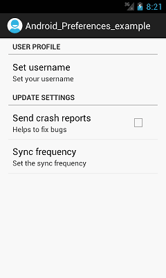

# Лабораторная работа №14

## Создание группы настроек приложения

### Основные правила

1. Не бойтесь **задавать любые вопросы**
2. Если хотите сделать что-то свое - **предлагайте**, будем думать
3. Советую читать текст: здесь написано много полезного

### О чем лабораторная?

В приложениях настройки часто объединяют в группы по смыслу. Например, параметры внешнего вида находятся в одном разделе, а параметры уведомлений - в другом.

Сегодня создадим экран настроек приложения и разделим параметры на несколько логических групп. Для этого будем использовать знакомые компоненты: `LinearLayout`, `TextView`, `CheckBox`, `Switch` и другие элементы интерфейса.

---

### Часть 1. Создаем экран настроек

#### Задание

Выберите одну из тем:

1. **Книжный каталог** - отображение обложек (вкл/выкл), сортировка, уведомления о новых книгах и т.д.
2. **Каталог растений** - отображение фотографий, напоминания об уходе (вкл/выкл), единицы измерения и т.д.
3. **Каталог товаров** - отображение цен, изображений и уведомлений о скидках (вкл/выкл) и т.д.
4. **Своя тема** - придумайте приложение и настройки, которые подходят именно ему и т.д.

Создайте вертикальный контейнер `LinearLayout`. Внутри него разместите заголовок:

**Настройки приложения ...**

Под заголовком будут находиться *группы параметров*. Для каждой группы предусмотрите:

- название раздела
- один или несколько элементов настройки



Например, экран может содержать разделы "Внешний вид" и "Уведомления".

> **Самостоятельное задание:** назначьте элементам подходящие `id`

### Часть 2. Создаем первую группу - "Внешний вид"

В этой группе разместим параметры, связанные с отображением приложения.

Добавьте заголовок **Внешний вид**, а под ним два элемента:

1. `CheckBox` с подписью "Показывать изображения"
2. `CheckBox` с подписью "Показывать описания"

**`CheckBox` подходит для параметра, который можно независимо включать и
выключать.**

Пример элемента:

``` xml
<CheckBox
    android:id="@+id/checkImages"
    android:layout_width="match_parent"
    android:layout_height="wrap_content"
    android:text="Показывать изображения" />
```

Чтобы визуально отделить группу от остальных настроек, можно:

- добавить отступы через `android:padding` или `android:layout_margin`
- использовать отдельный вложенный `LinearLayout`
- выделить заголовок группы размером текста или начертанием

Не нужно использовать все способы сразу. Выберите оформление, при котором раздел легко заметить.

> **Самостоятельное задание:** создайте группу "Внешний вид" с двумя флажками и настройте отступы так, чтобы заголовок и параметры воспринимались как единый раздел

### Часть 3. Создаем вторую группу - "Уведомления"

Добавьте еще один раздел - **Уведомления**.

Внутри разместите `CheckBox` с подписью "Получать уведомления".

Теперь экран должен содержать две визуально различимые группы:

- "Внешний вид"
- "Уведомления"

Проверьте, что элементы находятся в правильных разделах, а между группами есть визуальный отступ.

> **Самостоятельное задание:** придумайте и добавьте еще один параметр для одной из групп. Он должен подходить по смыслу к выбранному разделу.

### Часть 4. Добавляем настройку с переключателем

Не все настройки обязательно оформлять флажком. Добавим переключатель `Switch`, который позволяет включать и выключать один параметр.

Разместите в группе "Внешний вид" переключатель с подписью **Темная тема**

Пример:

``` xml
<Switch
    android:id="@+id/switchDarkTheme"
    android:layout_width="match_parent"
    android:layout_height="wrap_content"
    android:text="Темная тема" />
```

На этом этапе переключатель должен менять свое визуальное состояние при нажатии. Реализовывать настоящее переключение оформления всего приложения не требуется.

> **Самостоятельное задание:** добавьте в одну из групп еще один подходящий элемент настройки. Не дублируйте уже созданный параметр.

---

### Требования

1. Создан экран настроек приложения
2. Настройки разделены минимум на две логические группы
3. У каждой группы есть отдельный заголовок
4. В каждой группе находится не менее двух параметров
5. Используются `CheckBox` и `Switch`
6. Группы визуально различаются с помощью расположения и отступов
7. Все текстовые надписи вынесены в `strings.xml`
8. Приложение запускается, а элементы интерфейса отображаются корректно

### Дополнительно

1. Добавьте кнопку "Сбросить настройки", которая возвращает элементы интерфейса в исходное состояние
2. Добавьте короткое пояснение под одной из настроек, используя дополнительный `TextView`
3. Реализуйте прокрутку с помощью `ScrollView`
