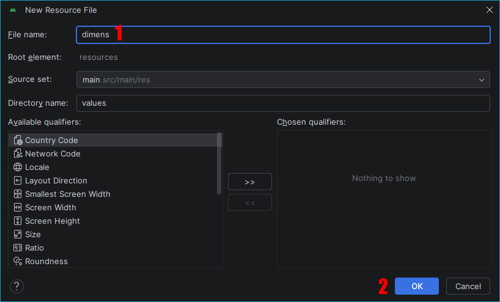

# Лабораторная работа №16

## Использование ресурсов dimension

### Основные правила

1. Не бойтесь задавать любые вопросы
2. Если хотите сделать что-то свое, то предлагайте - будем думать
3. Советую читать текст, тут написано **много полезного**

### О чем лабораторная?

При создании интерфейса Android-приложения мы задаем размеры элементов, отступы, высоту кнопок и другие параметры. Например, указываем, что заголовок должен иметь размер текста 24sp, а между группами настроек должен быть отступ 16dp.

Если записывать все размеры непосредственно в XML-разметке, при изменении оформления придется **искать нужные значения в разных местах проекта.**

В Android для хранения размеров предусмотрены **ресурсы dimension**. Они позволяют вынести размеры в отдельный файл и обращаться к ним по имени.

Ресурсы размеров обычно хранятся в файле:

`res/values/dimens.xml`

Сегодня мы создадим ресурсы размеров, подключим их в XML-разметке и проверим, как изменение одного ресурса влияет на внешний вид приложения.

---

### Часть 1. Создаем экран приложения

Для начала создайте простой экран настроек приложения. Можно использовать тему из [лабораторной работы №14](https://github.com/aiinty/labs/blob/main/андр/14-лаб-создание-группы-настроек.md): например, настройки каталога растений, книжного каталога или приложения на свою тему.

На экране должны быть:

- используйте вертикальный контейнер `LinearLayout`
- заголовок "Настройки приложения"
- заголовок группы "Внешний вид"
- флажок `CheckBox` с подписью "Показывать изображения"
- флажок `CheckBox` с подписью "Показывать описания"
- заголовок группы "Уведомления"
- флажок `CheckBox` с подписью "Получать уведомления"

На этом этапе можно задавать размеры и отступы непосредственно в XML-разметке, например:

```xml
<TextView
    android:layout_width="match_parent"
    android:layout_height="wrap_content"
    android:text="@string/settings_title"
    android:textSize="24sp"
    android:padding="16dp" />
```

Обратите внимание на два атрибута:

- `android:textSize` - размер текста
- `android:padding` - внутренний отступ элемента

> **Самостоятельное задание:** настройте размеры текста и отступы так, чтобы группы визуально отличались друг от друга.

### Часть 2. Создаем файл ресурсов размеров

Откройте папку:

`res/values/`

Создайте файл `dimens.xml` - **New -> Values Resource File**:


Укажите имя `dimens`:



В этом файле можно расположить следующие ресурсы:

```xml
<?xml version="1.0" encoding="utf-8"?>
<resources>
    <dimen name="text_size_title">24sp</dimen>

    <dimen name="spacing_small">8dp</dimen>

    <dimen name="button_height">48dp</dimen>
</resources>
```

У ресурса размера есть два основных элемента:

- `name` - имя, по которому к ресурсу обращаются в XML или коде
- **значение с единицей измерения** - размер, который будет использоваться приложением

Например:

```xml
<dimen name="spacing_medium">16dp</dimen>
```

Здесь `spacing_medium` - имя ресурса, а `16dp` - его значение

Имена ресурсов обычно записывают латинскими буквами в нижнем регистре, используя подчеркивания.

Важно: файл `dimens.xml` должен находиться внутри `<resources>`. Если в проекте уже есть другие файлы ресурсов, удалять их не нужно.

> **Самостоятельное задание:** создайте **не менее 5 ресурсов размеров** для своего приложения. Предусмотрите размеры текста и несколько вариантов отступов

### Часть 3. Используем ресурсы размеров в XML

Чтобы обратиться к ресурсу dimension в XML-разметке, используется ссылка вида:

`@dimen/имя_ресурса`

Например:

```xml
android:textSize="@dimen/text_size_title"
```

Теперь заменим числовые значения в заголовке на ссылки на ресурсы:

```xml
<TextView
    android:id="@+id/txtTitle"
    android:layout_width="match_parent"
    android:layout_height="wrap_content"
    android:text="@string/settings_title"
    android:textSize="@dimen/text_size_title"
    android:padding="@dimen/spacing_small" />
```

Здесь:

- `@string/settings_title` - ссылка на строковый ресурс как в [лабораторной работы №15](https://github.com/aiinty/labs/blob/main/андр/15-лаб-создание-строковых-ресурсов.md)
- `@dimen/text_size_title` - ссылка на ресурс размера текста
- `@dimen/spacing_small` - ссылка на ресурс отступа

Таким образом, текст и размеры хранятся отдельно от разметки.

Например, можно использовать ресурсы для следующих атрибутов:

- `android:textSize`
- `android:padding`
- `android:layout_margin`
- `android:layout_height`
- `android:layout_width`

> **Самостоятельное задание:** подключите ресурсы dimension ко всем элементам на экране и настройте отступы между элементами

### Часть 4. Разбираемся с единицами измерения

В Android при задании размеров используются разные единицы измерения.

**`dp` (density-independent pixels)** - единицы, предназначенные для задания размеров элементов интерфейса и отступов с учетом плотности экрана.

Примеры:

- `8dp` - небольшой отступ
- `16dp` - стандартный отступ
- `48dp` - пример высоты элемента управления

**`sp` (scale-independent pixels)** - единицы, предназначенные прежде всего для размера текста. Они учитывают настройки масштаба шрифта пользователя.

Примеры:

- `14sp` - небольшой текст
- `16sp` - обычный текст
- `24sp` - крупный заголовок

> В качестве общего правила:
>
> - размеры текста задавайте в `sp`
> - отступы, размеры контейнеров и элементов интерфейса обычно задавайте в `dp`

Не путайте эти единицы: `16dp` и `16sp` **не обязательно будут выглядеть одинаково.**

---

### Самостоятельное задание

Доработайте экран настроек своего приложения.

1. Создайте минимум **6 ресурсов** dimension
2. Вынесите **размеры заголовка** экрана и заголовков групп в ресурсы
3. Вынесите **отступы** между группами и элементами в ресурсы
4. Используйте один и тот же ресурс отступа минимум в **3 местах**
5. Добавьте кнопку с высотой, заданной через **ресурс** dimension

> Можно использовать тему каталога растений, книжного каталога, каталога товаров или собственную тему

### Требования

1. Создан файл `res/values/dimens.xml`
2. Объявлено не менее 6 ресурсов размеров
3. В XML-разметке используются ссылки `@dimen/...`
4. Размеры текста задаются в `sp`, а отступы - в `dp`
5. Один ресурс используется минимум в **3 местах**
6. Изменение ресурса влияет на внешний вид соответствующих элементов
7. Приложение запускается без ошибок

### Дополнительно

Сравните два варианта разметки: с числовыми значениями и со ссылками на ресурсы dimension. Объясните, какой вариант удобнее поддерживать и почему
