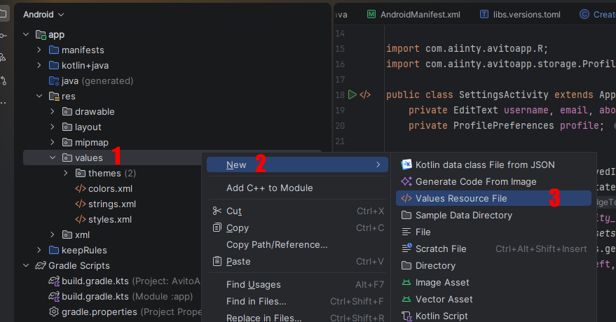

# Лабораторная работа №17

## Создание и использование ресурсов цветов

### Основные правила

1. Не бойтесь задавать любые вопросы
2. Если хотите сделать что-то свое, то предлагайте - будем думать
3. Советую читать текст, тут написано **много полезного**

### О чём лабораторная?

Цвета играют важную роль в оформлении Android-приложений. С их помощью можно выделять отдельные элементы интерфейса, создавать контраст между текстом и фоном и задавать единый стиль приложения.

Если указывать цвета непосредственно в XML-разметке, **при изменении оформления придётся искать нужные значения в разных местах проекта.**

В Android для хранения цветов предусмотрены цветовые ресурсы. Они позволяют вынести цвета в отдельный файл и обращаться к ним по имени.

Цветовые ресурсы обычно хранятся в файле:

`res/values/colors.xml`

### Часть 1. Создаём палитру цветов

Создадим приложение "Палитра цветов". Его задача - демонстрировать разные цвета и их названия.

На экране необходимо разместить:

- заголовок "Палитра цветов"
- не менее шести цветных областей
- название каждого цвета внутри соответствующей области

Для размещения элементов используйте `LinearLayout`, `GridLayout` или другой подходящий контейнер.

Каждая область должна иметь собственный цвет фона и текст с названием цвета.

Пример цветной области:

```xml
<TextView
    android:layout_width="match_parent"
    android:layout_height="80dp"
    android:gravity="center"
    android:text="Красный"
    android:textSize="18sp"
    android:textColor="#FFFFFF"
    android:background="#F44336" />
```

Здесь:

- `android:background` задаёт цвет фона
- `android:textColor` задаёт цвет текста
- `android:gravity="center"` размещает текст по центру области

> **Самостоятельное задание**: создайте палитру минимум из шести цветов. Подберите цвет текста для каждой области так, чтобы надписи хорошо читались.

### Часть 2. Разбираемся с записью цветов

В Android цвет можно записать с помощью **шестнадцатеричного значения.**

Например:

```xml
android:background="#FF0000"
```

Значение `#FF0000` обозначает красный цвет.

В формате `#RRGGBB`:

- `RR` - сколько красного
- `GG` - сколько зелёного
- `BB` - сколько синего

Каждая пара задаётся шестнадцатеричным числом от `00` до `FF`.

Примеры цветов:

| Значение  | Цвет       |
| --------- | ---------- |
| `#000000` | Чёрный     |
| `#FFFFFF` | Белый      |
| `#FF0000` | Красный    |
| `#00FF00` | Зелёный    |
| `#0000FF` | Синий      |
| `#FFFF00` | Жёлтый     |
| `#FF9800` | Оранжевый  |
| `#9C27B0` | Фиолетовый |
| `#808080` | Серый      |
| `#795548` | Коричневый |

> **Задание**: измените несколько цветов в своей палитре. Попробуйте использовать значения из таблицы и придумать собственные сочетания.

### Часть 3. Создаём файл цветовых ресурсов

Откройте папку:

`res/values/`

Создайте файл `colors.xml`:

1. Нажмите правой кнопкой мыши на папку `values`
2. Выберите `New -> Values Resource File`
    
3. В поле имени укажите `colors`
4. Подтвердите создание файла

Если `colors.xml` уже существует, **второй файл создавать не нужно.** Добавьте новые ресурсы в существующий файл.

Разместите в нём следующие ресурсы:

```xml
<?xml version="1.0" encoding="utf-8"?>
<resources>

    <color name="palette_red">#F44336</color>
    <color name="palette_blue">#2196F3</color>
    <color name="palette_green">#4CAF50</color>

    <color name="palette_white">#FFFFFF</color>
    <color name="palette_black">#000000</color>

</resources>
```

У каждого цветового ресурса есть два основных элемента:

- `name` - имя, по которому к ресурсу обращаются в XML или коде
- **значение цвета** - шестнадцатеричный код, определяющий цвет

Например:

```xml
<color name="palette_blue">#2196F3</color>
```

Здесь `palette_blue` - имя ресурса, а `#2196F3` - его значение

Важно: все ресурсы должны находиться внутри тега `<resources>`. Если в файле уже есть другие ресурсы, **удалять их не нужно.**

> **Самостоятельное задание**: создайте **не менее 8 цветовых ресурсов**. Помимо основных цветов, добавьте собственные оттенки.

### Часть 4. Подключаем цветовые ресурсы в XML

Чтобы обратиться к цветовому ресурсу в XML-разметке, используется ссылка вида:

`@color/имя_ресурса`

Например:

```xml
android:background="@color/palette_blue"
```

Android найдёт ресурс `palette_blue` в `colors.xml` и использует его значение.

Теперь замените прямые значения цветов в своей палитре ссылками на созданные ресурсы.

Например, красная область будет выглядеть так:

```xml
<TextView
    android:id="@+id/txtRed"
    android:layout_width="match_parent"
    android:layout_height="80dp"
    android:gravity="center"
    android:text="Красный"
    android:textSize="18sp"
    android:textColor="@color/palette_white"
    android:background="@color/palette_red" />
```

Обратите внимание: для текста используется ресурс `@color/palette_white`, а для фона - ресурс конкретного цвета.

Таким образом, цвет фона и цвет текста можно хранить отдельно и использовать повторно.

> **Самостоятельное задание**: подключите цветовые ресурсы ко всем 6 областям палитры

### Требования

1. Создан или дополнен файл `res/values/colors.xml`
2. Объявлено не менее восьми цветовых ресурсов
3. На экране отображается палитра из шести или более областей
4. В XML используются ссылки `@color/...`
5. Один ресурс используется минимум в трёх местах
6. Продемонстрировано изменение цвета после редактирования ресурса
7. Приложение запускается без ошибок
