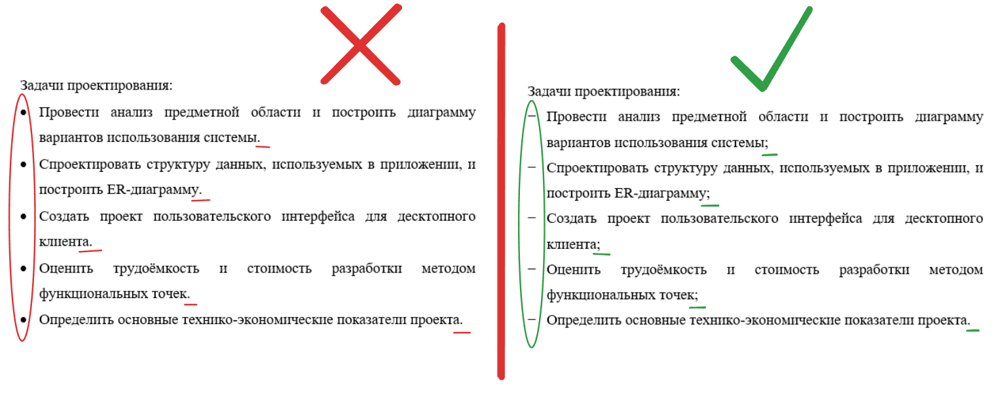
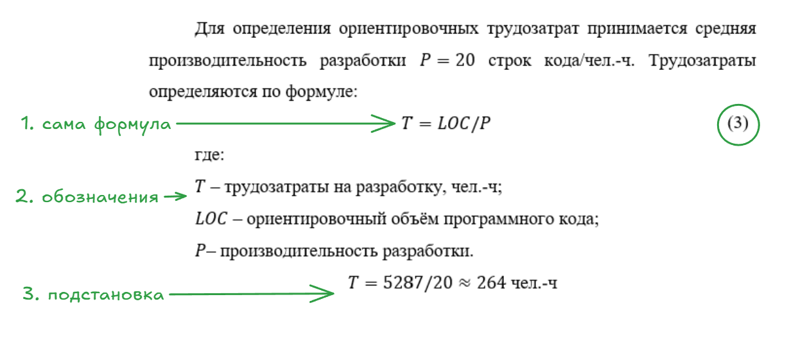
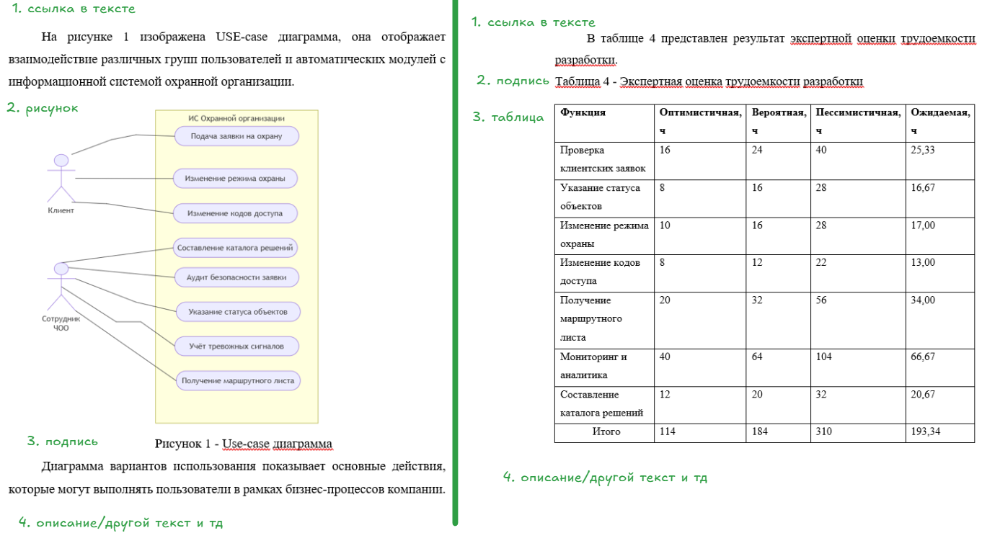
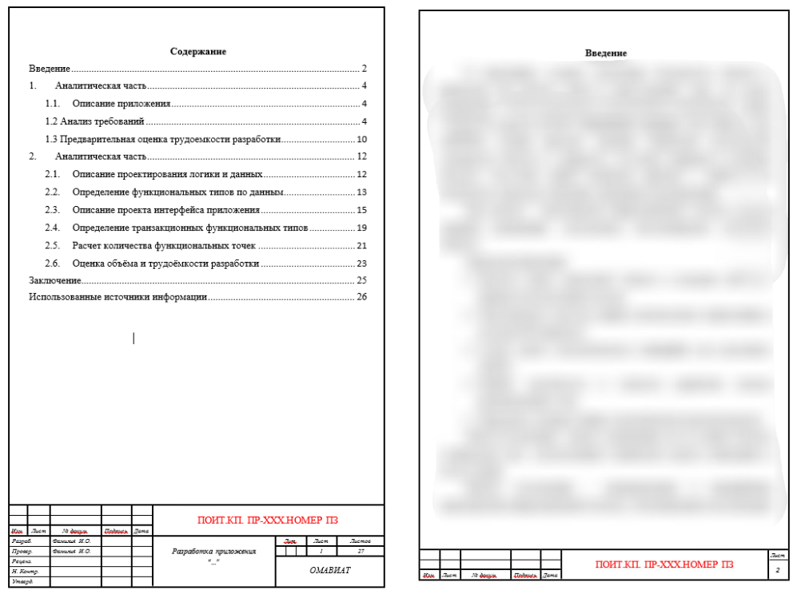

# Требования к оформлению курсовой работы

**При оформлении курсовой работы необходимо соблюдать следующие требования:**

## 0. Оформление темы

Шаблон для темы:

> 1. Проектирование варианта использования системы и оценка при планировании проекта «Разработка информационной системы “___”»
> 2. Проектирование варианта использования системы и оценка при планировании проекта «Разработка приложения “___”»
> 3. Проектирование варианта использования системы и оценка при планировании проекта «Разработка мобильного приложения “___”»

Заместо `“___”` должно быть название приложения/системы.

## 1. Основные параметры оформления

- Шрифт - **Times New Roman**
- Размер шрифта - **14** (в таблицах можно 12)
- Межстрочный интервал - **1,5**
- Основной текст должен быть выровнен **по ширине**

## 2. Оформление списков

- Списки оформляются *либо нумерованными*, *либо с использованием символа дефиса*
- **Списки с точками - не используем**
- В конце каждого пункта списка ставится точка с запятой, в конце самого последнего пункта ставим *точка*

## 3. Оформление формул

Формулы оформляются в следующем порядке:

1. Сначала приводится сама формула с её номером в круглых скобках (1), (2) и т. д.
2. После формулы приводится описание используемых обозначений
3. После этого выполняется подстановка числовых значений в формулу и приводится результат расчёта
4. Для обозначения умножения используем точку "⋅", а не звездочку "*" или крестик "×"

## 4. Оформление таблиц и рисунков

- Все таблицы и рисунки должны иметь **подписи**
  - У рисуноков подпись расположена *под ними по центру*
  - У таблиц подпись *перед ними у левого края*
- Все таблицы и рисунки должны иметь **нумерацию**
- Перед каждой таблицей или рисунком **в тексте обязательно должна быть ссылка на него**
- Ссылки оформляются в виде предложения, например: "На рисунке 1 представлена диаграмма вариантов использования" или "В таблице 1 представлены результаты расчётов"
- Первой должна идти **ссылка в тексте** на таблицу/рисунок и следующим **сама** таблица/рисунок

## 5. Шаблон курсового проекта

Шаблон находится в `Шаблон.docx`. Первый лист - **титульный**, второй лист - **содержание**, а следующие - **ваша работа**.

