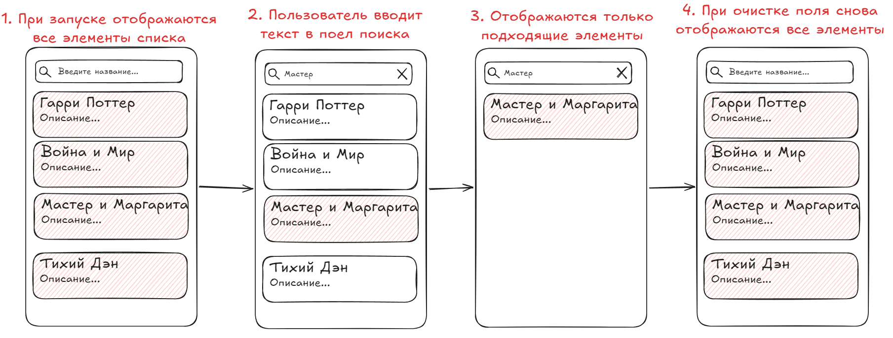

# Лабораторная работа №21

## Реализация поиска и фильтрации элементов списка

### Основные правила

1. Не бойтесь **задавать любые** вопросы
2. Если хотите сделать что-то свое, то **предлагайте** – будем думать
3. Советую читать текст, тут написано много **полезного**

### О чем лабораторная?

На прошлых занятиях вы научились создавать списки и добавлять пагинацию. Сегодня добавим в приложение поиск. Он позволит пользователю находить нужные элементы по названию, не просматривая весь список вручную.

Например, в каталоге книг можно ввести название книги и увидеть только те элементы, которые соответствуют запросу.

---

### Часть 1. Теория

#### Как работает поиск?

Представим, что у нас есть список книг:

* Гарри Поттер
* Война и мир
* Преступление и наказание
* Мастер и Маргарита
* Три товарища

Пользователь вводит в поле поиска слово "Мастер". Приложение проверяет названия книг и оставляет в отображаемом списке только подходящие элементы.

Если пользователь очистит поле поиска, приложение *снова покажет все книги*.

Таким образом, поиск состоит из трёх действий:

1. **Получить текст**, введённый пользователем
2. **Найти элементы**, соответствующие запросу
3. **Обновить список** на экране

#### Как отслеживать ввод текста?

Для отслеживания изменений в `EditText` используется `TextWatcher`.

Пример:

```java
editTextSearch.addTextChangedListener(new TextWatcher() {
    @Override
    public void beforeTextChanged(CharSequence s, int start, int count, int after) {
        // 
        // этот метод вызывается ПЕРЕД при изменении текста
        //
    }

    @Override
    public void onTextChanged(CharSequence s, int start, int before, int count) {
        // 
        // этот метод вызывается СРАЗУ при изменении текста
        //
    }

    @Override
    public void afterTextChanged(Editable s) {
        // 
        // этот метод вызывается ПОСЛЕ изменения текста
        //
    }
});
```

Метод `onTextChanged()` вызывается каждый раз, когда пользователь изменяет текст в поле. В нашем случае введённая строка передаётся адаптеру для поиска.

#### Как найти нужные элементы?

Для поиска в строках можно использовать метод `contains()`. Он проверяет, содержится ли одна строка внутри другой.

```java
String title = "Гарри Поттер";
String query = "Поттер"; // query - поисковый запрос

if (title.toLowerCase().contains(query.toLowerCase())) {
    // попадаем сюда если title СОДЕРЖИТ в себе поисковый запрос
}
```

Метод `toLowerCase()` позволяет выполнять поиск без учёта регистра. Например, запросы "поттер" и "ПОТТЕР" **дадут одинаковый результат.**

Метод `trim()` можно использовать для удаления лишних пробелов в начале и конце поискового запроса.

#### Почему нужны два списка?

В адаптере придется хранить два списка:

* `fullList` - исходный список, содержащий все элементы
* `filteredList` - список элементов, которые отображаются после поиска

Зачем это нужно?

Допустим, пользователь ввёл "Мастер", и на экране **осталась только одна книга**. Если удалять найденные элементы из исходного списка, остальные книги **могут потеряться из поиска.**



Поэтому мы должны **полностью сохранить исходный список**, и сформировать **отдельный для отображения**, который как раз уже будет содержать то что нам нужно.

После очистки поискового поля отображаемый список снова заполняется элементами из `fullList`.

---

### Часть 2. Самостоятельная работа

#### Задание

Продолжите работу над приложением со списком, созданным на предыдущих занятиях. Используйте свой существующий `RecyclerView` и адаптер.

Если предыдущего проекта нет, то выберите одну из тем:

1. **Лента новостей** - поиск по заголовку новости, фильтрация по категории (политика, спорт, экономика)
2. **Каталог товаров** - поиск по названию товара, фильтрация по категории (электроника, одежда, продукты)
3. **Список задач** - поиск по названию задачи, фильтрация по статусу (все, выполненные, невыполненные)
4. **Плейлист** - поиск по имени контакта или исполнителю
5. **Своя тема** - любой список с поиском и фильтрацией

#### Шаг 1. Добавьте поле поиска

Добавьте на ваш экран `EditText`, расположив его над RecyclerView.

```xml
<EditText
    android:id="@+id/editTextSearch"
    android:layout_width="match_parent"
    android:layout_height="wrap_content"
    android:hint="Введите название для поиска"
    android:inputType="text" />
```

Подключите его в `Activity` с помощью `findViewById()`.

#### Шаг 2. Подготовьте адаптер

Добавьте в адаптер два списка:

```java
private List<Book> fullList;
private List<Book> filteredList;
```

Здесь `Book` - класс-модель вашего приложения. Если вы используете другую модель, укажите её тип вместо `Book`.

При создании адаптера сохраните исходные данные и подготовьте список для отображения:

```java
public BookAdapter(List<Book> bookList) {
    this.fullList = bookList;
    this.filteredList = new ArrayAdapter(bookList); // сразу подготавливаем такой же список для отображения
}
```

> Не забудьте изменить `getItemCount()` и `onBindViewHolder()`, чтобы отображались элементы из `filteredList`, а не `fullList`

#### Шаг 3. Реализуйте поиск

Добавьте в адаптер метод `public void filter(String text)`:

```java
public void filter(String text) {
    // 1. очищаем список отображаемых элементов
    filteredList.clear();
    
    if (text.isEmpty()) {
        // 2. если текст пустой - отображаем все
        filteredList.addAll(fullList);
    } else {
        // 3. иначе ищем в каждом элементе эту строку
        String query = text.toLowerCase().trim();

        // 4. перебераем исходный список
        for (Book item : fullList) {
            // 5. для каждого проверяем - содержит ли его название введённый текст
            if (item.getTitle().toLowerCase().contains(query)) {
                // 6. если нашли совпадение, то добавляем в отфильтрованный список
                filteredList.add(item);
            }
        }
    }

    // 7. не забываем сказать адаптеру перерисовать строчки
    notifyDataSetChanged(); 
}
```

#### Шаг 4. Подключите поиск

В `MainActivity` отслеживайте ввод в поле поиска при помощи [данного инструмента](#как-отслеживать-ввод-текста)

При каждом изменении текста - вызывайте у адаптера `.filter()`, чтобы поиск выполнялся сразу по вводу.

---

### Итоговые требования

1. Приложение отображает список с помощью `RecyclerView`
2. Есть `EditText` для поиска по тексту
3. Поиск выполняется при вводе текста без отдельной кнопки
4. Результаты поиска обновляются сразу
5. При очистке поля отображается исходный список

### Дополнительно

1. Сделайте так, чтобы поиск осуществлялся по двум `String` полям. В примере поиск осуществлялся только по названию, потому надо было бы сделать еще и поиск по автору - в зависимости от вашей темы
2. Сделайте фильтр по категориям/видам/т.д.
