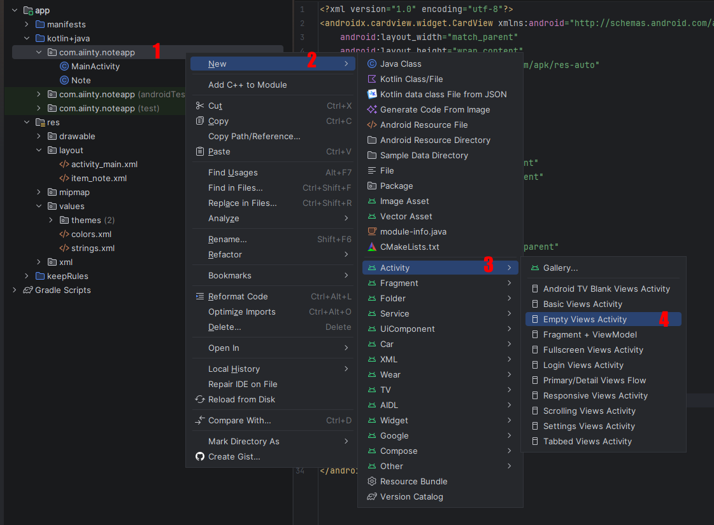
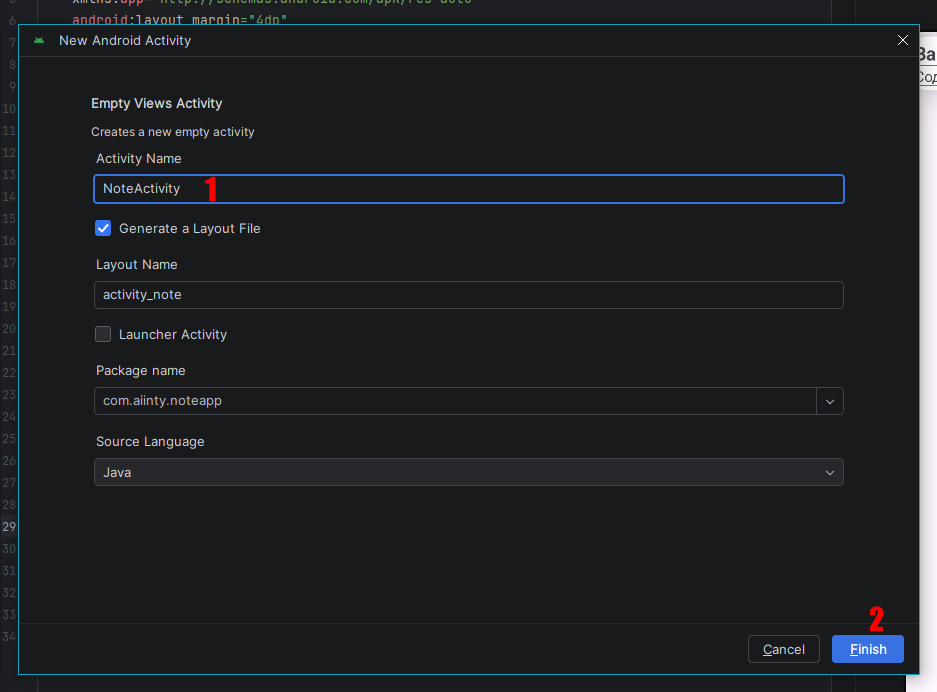

# Лабораторная работа №22

## Разработка интерфейса приложения для ведения заметок

### Основные правила

1. Не бойтесь **задавать любые** вопросы
2. Если хотите сделать что-то свое, то **предлагайте** - будем думать
3. Советую читать текст, тут написано много **полезного**

### О чем лабораторная?

Сегодня начинаем разработку приложения для ведения заметок. На этом занятии создадим интерфейс: экран со списком заметок и экран создания/редактирования заметки. Функциональность добавим на следующей паре.

---

### Часть 1. Модель данных

Создайте класс `Note` - это будет наша заметка. В нем должны быть:

- Поля: числовой `id`, строковый `title`, строковй `content`, `createdAt` типа `Instant`
- Конструктор, принимающий `id`, `title`, `content`
- Геттеры и сеттеры для всех полей

> Если забыли, как создается **класс-модель**, то загляните в [раздел про модель](https://github.com/aiinty/labs/blob/main/мобпри/17-урок-recyclerview.md#шаг-1-создайте-модель-данных), там есть пример

---

### Часть 2. Экран списка заметок

Создайте `activity_main.xml`. На экране должны быть:

- `TextView` заголовок - "Заметки"
- `RecyclerView` для списка заметок
- `Button` "+" для добавления заметки

Создайте макет элемента списка `item_note.xml`. Каждый элемент должен показывать:

- Заголовок заметки (жирным шрифтом)
- Превью содержимого (не более 2 строк, обрезать многоточием)

У `TextView` есть такие свойства, которые будут полезными:

```xml
android:maxLines="2"
android:ellipsize="end"
```

---

### Часть 3. Экран создания/редактирования заметки

Создайте `activity_note.xml`, чтобы создать новый экран нужно:

1. Содаем `Empty Views Activity`

2. Вводим название нашего экрана `NoteActivity`, название разметки (`Layout Name`) подстроится само, остальное не трогаем


На экране должны быть:

- `Button` "Сохранить"
- `Button` "Удалить"
- `EditText` для заголовка (одна строка)
- `EditText` для содержимого (многострочный, на весь оставшийся экран)

---

### Часть 4. Адаптер для списка заметок

Создайте класс `NoteAdapter`, который:

- Наследуется от `RecyclerView.Adapter`
- Хранит список `Note` и в конструкторе принимает `List<Note>`
- В `onCreateViewHolder` создает объекты класса `NoteViewHolder`
- В `onBindViewHolder` заполняет карточку

> Если забыли, как создается **адаптер**, то загляните в [раздел про адаптеры](https://github.com/aiinty/labs/blob/main/мобпри/17-урок-recyclerview.md#шаг-4-создайте-адаптер)

---

### Итоговые требования

1. Приложение отображает список заметок с помощью `RecyclerView`
2. Каждый элемент списка показывает заголовок и превью содержимого
3. Все текстовые данные вынесены в `strings.xml`

### Дополнительно

Пусть в карточке записки также выводится `createdAt`. Для начала надо `Insant` преобразовать в `String`.

Подсказка:

```java
// настраиваем красивый вывод
DateTimeFormatter formatter = DateTimeFormatter.ofPattern("dd.MM.yyyy HH:mm");

// получаем красивую дату в виде строки
String dateStr = currentNote.getCreatedAt().atZone(ZoneId.systemDefault()).format(formatter);

// выводим
holder.textDate.setText(dateStr);
```
