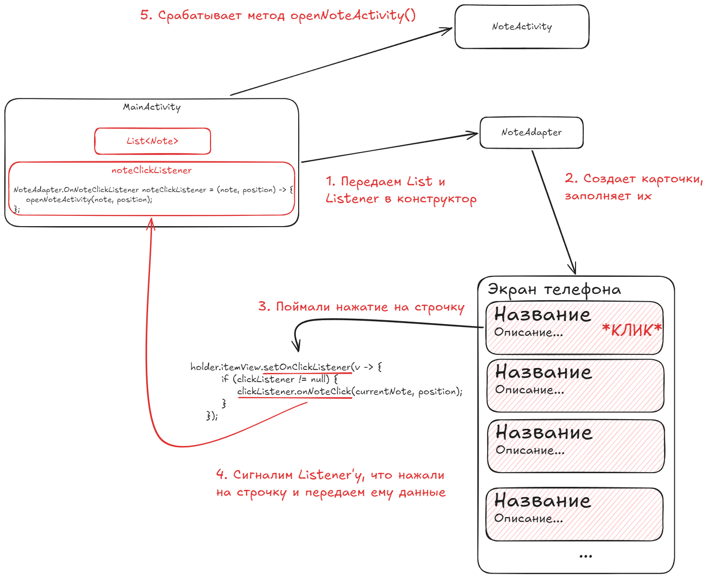

# Лабораторная работа №23

## Реализация функциональности приложения для ведения заметок

### Основные правила

1. Не бойтесь **задавать любые** вопросы
2. Если хотите сделать что-то свое, то **предлагайте** - будем думать
3. Советую читать текст, тут написано много **полезного**

### О чем лабораторная?

На прошлом занятии мы создали интерфейс приложения для ведения заметок. Сегодня добавим функциональность: создание, редактирование и удаление заметок.

---

### Часть 1. Обработка нажатия

В Android  строгое разделение:

1. `NoteAdapter` **(Адаптер)** - это отвечает за оформление. Его **единственная задача** - взять XML-макеты, создать карточки и заполнить их. Адаптер ***не имеет права управлять логикой приложения*** (например, открывать новые экраны), так как он ничего не знает о контексте всего приложения.
2. `MainActivity` **(Активность)** - это ответственный за экран. **Только активность** имеет контекст, достаточный для навигации, запуска других экранов и получения ответов от них.

Потому чтобы *адаптер* мог сообщить *активности*:

> Пользователь нажал на карточку заметки, сделай с ней что-нибудь!

используется **Callback** (или же можно назвать триггер) через `interface`. interface здесь выступает в роли "розетки" в *адаптере*, к которой *активность* **подключается**.



Потому немного допишем наш адаптер:

1. Создадим наш `interface`
2. Создадим место для нашей "розетки" (добавим поле для объекта интерфейса)
3. Обязательно примем и заполним это место в конструкторе
4. Поймаем то, что нажали на карточки
5. Передаем что на карточку наажли

Пример:

```java
public class NoteAdapter extends RecyclerView.Adapter<NoteViewHolder> {
    List<Note> noteList;
    OnNoteClickListener clickListener; // 2. добавляем поле для слушателя

    // 1. создаем свой интерфейс
    public interface OnNoteClickListener {
        void onNoteClick(Note note, int position); // передаем заметку и её позицию в списке
    }

    // 3. не забываем принять слушателя в конструкторе
    public NoteAdapter(List<Note> noteList, OnNoteClickListener clickListener) {
        this.noteList = noteList;
        this.clickListener = clickListener;
    }

    @Override
    public void onBindViewHolder(@NonNull NoteViewHolder holder, int position) {
        Note currentNote = noteList.get(position);

        //... тут карточка заполняется ...

        // 4. обрабатываем слушаем НАЖАТИЕ на КАРТОЧКУ
        holder.itemView.setOnClickListener(v -> {
            // 5. вызываем у слушателя onNoteClick и передаем ему данные
            clickListener.onNoteClick(currentNote, position);
        });
    }

    //... тут дальше остальные методы getItemCount() и onCreateViewHolder()...
}

```

### Часть 2. Открываем другой экран по нажатию

При переходе на экран заметки нужно передать данные через `Intent`. Вот как это делается:

```java
public class MainActivity extends AppCompatActivity {

    List<Note> noteList = new ArrayList<>();
    NoteAdapter adapter;            // поле для адаптера
    int NOTE_REQUEST = 101;    // уникальный код для startActivityForResult
    int editedPosition = -1;        // поле чтобы запомнить то, какую заметку поменяли

    @Override
    protected void onCreate(Bundle savedInstanceState) {
        super.onCreate(savedInstanceState);
        //... остальной код до этого...

        // создаем переменную noteClickListener и тут же создаем слушателя
        NoteAdapter.OnNoteClickListener noteClickListener = (note, position) -> {
            openNoteActivity(note, position);
        };
        adapter = new NoteAdapter(noteList, noteClickListener);

        // так же делаем кнопку добавления для создания новой заметки
        Button buttonAdd = findViewById(R.id.btnAdd);
        buttonAdd.setOnClickListener(v -> {
            openNoteActivity(new Note(-1, "", ""), -1);
        });

        //... остальной код после этого...
    }

    // создаем отдельный метод для открытия экрана создания/редактирования
    private void openNoteActivity(Note note, int position) {
        editedPosition = position; // запоминаем, какую карточку меняем

        // cоздаем НАМЕРЕНИЕ и упаковываем в него данные заметки
        Intent intent = new Intent(this, NoteActivity.class);
        intent.putExtra("NOTE_ID", note.getId());
        /* ДАЛЕЕ ТУТ ТАКИМ ЖЕ ОБРАЗОМ ПОМЕСТИТЕ ПО КЛЮЧАМ - 

        title В "NOTE_TITLE" 
        content В "NOTE_CONTENT"
        */

        // запускаем НАМЕРЕНИЕ и ждем ответа
        startActivityForResult(intent, NOTE_REQUEST);
    }
}
```

А на экране создания/редактирования заметок **надо принять информацию**:

```java
public class NoteActivity extends AppCompatActivity {
    
    int noteId; // запоним айди заметки, чтоб вернуть его

    @Override
    protected void onCreate(Bundle savedInstanceState) {
        super.onCreate(savedInstanceState);
        //... остальной код до этого...

        // 1. достаем НАМЕРЕНИЕ и проверяем есть ли оно
        if (getIntent() != null) {
            Intent intent = getIntent();

            // 2. если есть, то достаем из него информацию по КЛЮЧАМ
            noteId = intent.getIntExtra("NOTE_ID", -1);
            String title = intent.getStringExtra("NOTE_TITLE");
            String content = intent.getStringExtra("NOTE_CONTENT");

            // 3. заполняем поля EditText полученными данными
            /* ТУТ САМОСТОЯТЕЛЬНО ЗАПОЛНИТЕ EditText`ы ДАННЫМИ 
            
            подсказка - используйте .setText()*/
        }

        //... остальной код после этого...
    }
}
```

Попробуйте запуститить приложение и нажать на заметку, должен открыться заполенный экран.

> Не забудьте временно заполнить список тестовыми `Note` из кода

---

### Часть 3. Передаем результат назад

Добавим в `NoteActivity` метод для передачи результата в `MainActivity`:

```java
private void saveAndReturn() {
    // 1. достаем введенный пользователем в поля текст
    String title = editTitle.getText().toString().trim();
    String content = editContent.getText().toString().trim();

    // 2. создаем пустой Intent (НАМЕРЕНИЕ) для отправки результата назад
    Intent resultIntent = new Intent();

    // 3. сохраняем по текстовым ключам
    /* ТУТ ПОМЕСТИТЕ В resultIntent: 

    title ПО КЛЮЧУ "UPDATED_TITLE" 
    content ПО КЛЮЧУ "UPDATED_CONTENT"

    подсказка - используйте .putExtra()
    */

    // 4. говорим Android: все прошло успешно (RESULT_OK) - вот посылка с данными
    setResult(RESULT_OK, resultIntent);

    // закрываем текущую Активити
    finish();
}
```

---

### Часть 4. Принимаем результат из NoteActivity

Когда пользователь напишет текст и нажмет кнопку "Сохранить", `NoteActivity` точно так же вернет строки обратно в `MainActivity`.

Потому `MainActivity` должен принять в методе `onActivityResult` результат:

```java
@Override
protected void onActivityResult(int requestCode, int resultCode, @Nullable Intent data) {
    super.onActivityResult(requestCode, resultCode, data);

    // проверяем, что вернулся нужный нам экран и операция прошла успешно
    if (requestCode == NOTE_REQUEST && resultCode == RESULT_OK && data != null) {
        
        // распаковываем новые строки
        String updatedTitle = ;
        String updatedContent  = ;
        /* ТУТ ДОСТАНЬТЕ ИЗ data СТРОКОВЫЕ ДАННЫЕ

        updatedTitle ИЗ "UPDATED_TITLE"
        updatedContent ИЗ "UPDATED_CONTENT"

        подсказка - используйте .getStringExtra()
        */

        if (editedPosition == -1) {
            // ДОБАВЛЕНИЕ: если позиция была -1, значит мы нажали кнопку btnAdd
            int newId = noteList.size() + 1; // создаем новый ID
            Note newNote = new Note(newId, updatedTitle, updatedContent);
            
            noteList.add(newNote); // добавляем новый элемент в список
            adapter.notifyItemInserted(noteList.size() - 1); //  уведомляем адаптер, что список изменился
        } else {
            // РЕДАКТИРОВАНИЕ: если позиция была передана из адаптера
            Note note = noteList.get(editedPosition);
            note.setTitle(updatedTitle);
            note.setContent(updatedContent);

            adapter.notifyItemChanged(editedPosition); // уведомляем адаптер, что изменилась карточка по сохраненному ID
        }
    }
}
```

---

### Итоговые требования

1. Можно создать новую заметку с заголовком и содержимым
2. Можно редактировать существующую заметку
3. Список обновляется после создания и редактирования
4. Все текстовые данные вынесены в `strings.xml`

### Дополнительно

1. Добавьте кнопку "Назад" в `NoteActivity`, чтобы отменить создание/редактирование
2. Реализуйте кнопку "Удалить" - кнопка может устанавливать например `setResult(100)` - потому надо будет обработать это в `MainActivity`.
