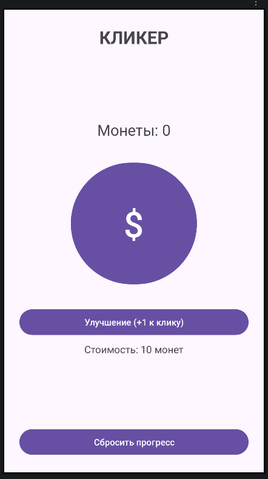

# Лабораторная работа №29

## Разработка интерфейса приложения для редактирования сохраненных данных

### Цель работы

Научиться создавать интерфейс для приложения который будет редактировать сохраенные данные.

### О чём лабораторная работа

В этой работе мы начнём создавать игру "Кликер". Игрок нажимает на кнопку, чтобы зарабатывать монеты. Также в игре будет кнопка улучшения, которая в дальнейшем позволит увеличивать количество монет за нажатие.

В этой лабораторной мы займёмся только интерфейсом. Игровую логику и сохранение прогресса реализуем в следующей работе.

### Задание

Создадим интерфейс игры-кликера, в котором присутствуют:

- количество заработанных монет
- кнопка с монетой для нажатий
- кнопка покупки улучшения
- информация о стоимости улучшения
- кнопка сброса прогресса

## Часть 1. Создание разметки

Откройте файл `activity_main.xml` и добавьте на него заголовок, текст для вывода количества монет, большую кнопку клика, кнопку улучшения с подписью под ней и кнопку сброса прогресса:



## Часть 2. Подготовка MainActivity

Откройте файл `MainActivity.java`. Пока нам нужно только связать элементы интерфейса с кодом, потому объявим **переменные** для элементов интерфейса:

```java
private TextView coinsTextView;
private TextView upgradeCostTextView;

private Button clickButton;
private Button upgradeButton;
private Button resetButton;
```

> **Заполните** их в `onCreate` при помощи `findViewById()` самостоятельно.

### Требования

1. Создать интерфейс игры согласно заданию
2. Связать элементы интерфейса с кодом при помощи `findViewById()`
3. Обеспечить корректное отображение всех элементов на экране

## Дополнительно (по желанию)

1. Измените внешний вид приложения на ваше усмотрение
2. Добавьте отображение количества монет за одно нажатие
