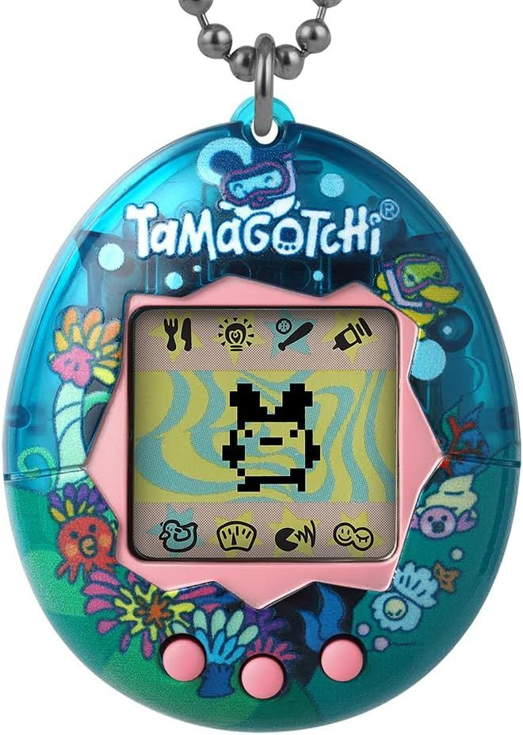

# Лабораторная работа №31

## Разработка приложения с сохранением данных

### Цель работы

Разработать функциональность мобильной игры с сохранением игрового состояния с помощью `SharedPreferences`

### О чём лабораторная работа

В предыдущей работе мы реализовали сохранение прогресса в приложении кликер, теперь сделаем пародию на тамагочи/мой говорящий том.

В этой игре пользователь сможет ухаживать за виртуальным питомцем. Игрок сможет кормить питомца, играть с ним и восстанавливать его энергию.

Каждое действие будет изменять характеристики питомца. Для сохранения игрового прогресса **необходимо** реализовать сохранение и восстановление характеристик с помощью `SharedPreferences`.

### Референсы

| 1 | 2 | 3 |
| :---: | :---: | :---: |
|  |  |  |

### Задание

Реализуйте следующие возможности:

1. Реализуйте **отображение** характеристик виртуального питомца при помощи отдельного метода:
   1. сытость
   2. счастье
   3. энергия
   4. игровая валюта
   > Пусть сытость, счастье, энергия будут в диапазоне **от 0 до 100**
2. Реализуйте кнопки действий с питомцем:
   1. **"Покормить"** - тратится Х монет, но увеличивает сытость на Y и счастье на Z
   2. **"Поиграть"** - тратится Х энергии и Y сытости, но прибавляется Z счастья
   3. **"Поспать"** - восстанавливает Х энергии
   > Не забудьте, что после выполнения любого действия нужно обновить интерфейс, чтобы показать актуальные характеристики питомца!
3. Реализуйте сохранения состояния приложения:
   1. Создайте в классе **поле** `private SharedPreferences preferences;` для хранения настроек
   2. В `onCreate()` после `setContentView(...)` создайте **хранилище** при помощи `getSharedPreferences(...)`
   3. Создайте отдельный метод для **сохранения** всей нужной информации и используйте его
   4. Создайте отдельный метод для **восстановления** состояния при запуске приложения и используйте его
4. **Сделайте красивый (очень) интерфейс**
   1. Пусть питомец будет отображаться картинкой, той которой вы захотите
   2. Сделайте так, чтобы в зависимости от характеристик отображался **разная картинка** питомца, например, если мало энергии - он сонный, если мало счастья - он грустный и т.д.  

## Требования

1. Реализовать взаимодействие с виртуальным питомцем
2. Реализовать изменение характеристик питомца в зависимости от действий пользователя
3. Реализовать сохранение и восстановление игрового прогресса с помощью `SharedPreferences`
4. Реализовать смену отображения разных состояний питомца при помощи изображений

## Дополнительно (по желанию)

1. Пусть при первом запуске можно ввести имя питомца, которое в дальнейшем будет отображаться где-то на экране
2. Добавьте уменьшение характеристик питомца в зависимости от времени отсутствия пользователя с использованием `System.currentTimeMillis()`. Подсказка:

   ```java
   // достаем из хранилища время последнего захода в приложение
   long lastTime = preferences.getLong("lastTime", System.currentTimeMillis());
   // получае текущее время
   long currentTime = System.currentTimeMillis();
   // считаем сколько секунд между ними прошло
   long elapsedSeconds = (currentTime - lastTime) / 1000;
   
   // ну и логика подсчета уменьшения характеристик 
   // в зависимости от количества прошедшего времени
   //
   // тут приведен пример - 
   // за каждую минуту с предыдущего запуска голод уменьшается на 5 
   int hungerDecrease = (int) (elapsedSeconds / 60) * 5;
   ```

3. Пусть можно купить/выбрать украшения для питомца, например - шляпу, накладные усы, нос клоуна и т.д.
4. Реализуйте автоматическое уменьшение характеристик питомца с использованием `Handler` и `Runnable`
