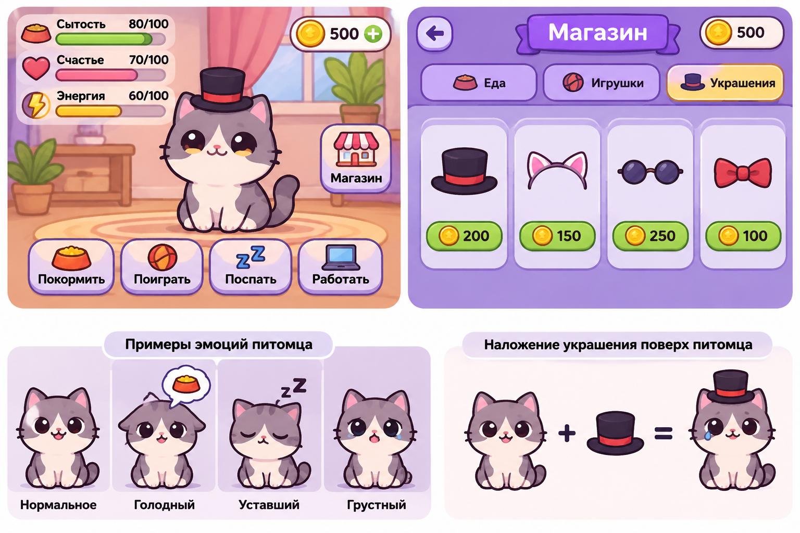

# Лабораторная работа №32

## Разработка приложения с сохранением данных 2

### Цель работы

Расширить функциональность мобильной игры с сохранением игрового состояния с помощью `SharedPreferences` из прошлой лабораторной работы

### О чём лабораторная работа

Теперь продолжим работу над приложением и добавим второй экран. На нём пользователь сможет приобретать предметы для питомца за игровые монеты для украшения питомца.

### Референсы

| 1 | 2 |
| :---: | :---: |
|  |  |
|  |  |

### Задание

Расширьте существующее приложение и реализуйте следующие возможности:

1. Создайте новую `Activity` для магазина питомца:
   1. Добавьте на главный экран **кнопку перехода** в магазин
   2. Реализуйте **открытие** второго экрана с помощью `Intent`
   3. На экране магазина обязательно предусмотрите **кнопку возврата** на главный экран
2. Второй экран должен содержать:
   1. количество игровых **монет**
   2. доступные **предметы** для покупки
   3. **стоимость** у каждого предмета

   Вы можете придумать **любые** предметы, названия, изображения и стоимость, например:

   | предмет | стоимость |
   | ---: | ---: |
   | бантик | 10 |
   | шляпа | 25 |
   | очки | 40 |

3. Реализуйте возможность покупки каждого предмета:
   1. Проверяем, **хватает ли** пользователю монет
   2. Если монет **достаточно** - списывем со счета стоимость предмета
   3. Отмечаем предмет **как купленный**, можно использовать `boolean` у которого может быть два состояния: `false` - предмет не куплен, `true` - куплен. Например:

   ```java
   // поле по умолчанию false, то есть шляпа не куплена
   private boolean isHatBought = false;
   // ...

   // проверка стоимости и что мы еще не купили шляпу
   if (money >= hatCost && isHatBought == false) {
      money -= hatCost;    // снимаем деньги с баланса
      isHatBought = true;  // отмечаем шляпу как купленную

      // так же не забываем вывести новый баланс в TextView!!
   } else {
      // иначе купить нельзя
   }

   ```

4. **Сделайте красивый (очень) интерфейс**
   1. По возвращению на главный экран - питомец должен **отображаться** с купленным предметом/предметами
   2. Сделайте так, чтобы под каждый предмет отображалась своя картинка

> [!WARNING]
> **ВАЖНО!**
>
> **Украшения должны отображаться поверх изображения питомца отдельным `ImageView`, а не быть частью общей картинки питомца.** Это позволит **легко** комбинировать украшения с разными эмоцими питомца.
>
> **ИНАЧЕ** для *каждого сочетания* придётся создавать *отдельное изображение*, например:
>
> **3 украшения * 4 эмоции = 12 отдельных картинок**
>
> Использование наложения позволит обойтись 4 изображениями эмоций питомца и 3 изображениями украшений, комбинируя их друг с другом без дополнительных сложностей.

## Требования

1. Создать вторую `Activity` и реализовать переходы между экранами с помощью `Intent`
2. Реализовать отображение баланса и списка предметов в магазине
3. Реализовать покупку предметов с проверкой количества монет
4. Сохранять и восстанавливать данные с помощью `SharedPreferences`
5. Обеспечить отображение выбранного предмета на главном экране

## Дополнительно (по желанию)

1. Добавьте возможность одеть/снять купленные украшения
2. Реализуйте несколько категорий/слотов для украшений: например, головной убор, очки и аксессуар
3. Добавьте возможность продавать купленные предметы за часть от их стоимости
