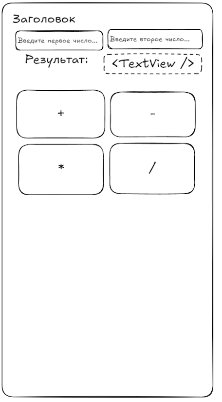

# Лабораторная работа №11

## Разработка интерфейса приложения "Простой калькулятор"

### Основные правила

1. Не бойтесь **задавать любые** вопросы.
2. Если хотите сделать что-то свое, то **предлагайте** - будем думать.
3. Советую читать текст, тут написано много **полезного**.

### О чем лабораторная?

Сегодня создадим интерфейс простого калькулятора для Android. На экране будут поле для ввода первого числа, поле для ввода второго числа, кнопки арифметических операций и область для отображения результата.

На следующем занятии добавим функциональность. Сейчас наша задача - создать интерфейс, в котором все элементы расположены удобно и понятно.

---

### Часть 1. Создаем интерфейс

На экране калькулятора должны быть следующие элементы:

1. Заголовок "Простой калькулятор"
2. Поле для ввода первого числа
3. Поле для ввода второго числа
4. Четыре кнопки: `+`, `−`, `*`, `/`
5. Надпись "Результат"
6. Поле для отображения результата

Подсказка: для полей ввода используется `EditText`, для кнопок - `Button`, для текстового результата - `TextView`

Например:

Для каждого элемента задайте подходящий идентификатор, чтобы к нему можно было обратиться из Java-кода.

Например, идентификаторы могут начинаться так:

- `edit...` - поля ввода
- `btn...` - кнопки
- `text...` - текстовые надписи

> **Самостоятельное задание:** придумайте понятные идентификаторы для всех элементов интерфейса.

#### Настраиваем поля ввода

Поля для чисел должны быть предназначены для ввода числовых значений, а не произвольного текста.

Изучите атрибут `android:inputType` и настройте оба поля ввода соответствующим образом.

Также добавьте подсказки *(hint)* внутри полей, чтобы пользователь понимал, какое число необходимо ввести.

> **Проверьте результат:** при нажатии на поле ввода появляется подходящая экранная клавиатура

---

### Требования

1. Создан экран простого калькулятора
2. Есть два поля для ввода чисел
3. Есть четыре кнопки арифметических операций
4. Предусмотрено место для вывода результата
5. Всем необходимым элементам назначены идентификаторы
6. Для полей ввода настроен подходящий тип клавиатуры
7. Все текстовые надписи вынесены в `strings.xml`

### Дополнительно

1. Добавьте кнопку очистки введённых данных
2. Измените оформление кнопок и области результата
3. Сделайте интерфейс удобным при изменении ориентации экрана
