# Гайд разработчика серверной части на PocketBase

## 1. Задачи разработчика серверной части

Разработчик серверной части:

- создает структуру базы данных в PocketBase
- создает коллекции, поля и связи между ними
- настраивает правила доступа
- добавляет тестовые данные
- проверяет работу API
- передает Android-разработчику структуру данных и адрес API
- поддерживает серверную часть во время интеграции и тестирования

## 2. Подключение к PocketBase

Для каждой проектной группы используется отдельный экземпляр PocketBase. **Адрес необходимо получить у руководителя практики**

Пример адреса группы 1:

```text
http://<адрес-сервера>:8081
```

Административная панель:

```text
http://<адрес-сервера>:8081/_/
```

> **Данные для входа под администратором выдаются руководителем практики**

API:

```text
http://<адрес-сервера>:8081/api/
```

Для каждой из групп меняется только порт.

## 3. Создание коллекций

Коллекция PocketBase соответствует сущности предметной области из ER-диаграммы.

Перед созданием коллекций необходимо свериться с:

- техническим заданием
- ER-диаграммой
- описанием прецедентов
- макетами экранов

Наприер, создадим коллекцию "Posts", которая будет хранить информацию о постах каких-то пользователей:

1. Зайдем в административную панель
2. Перейдите в раздел **Collections**
3. Нажмите **New collection**

   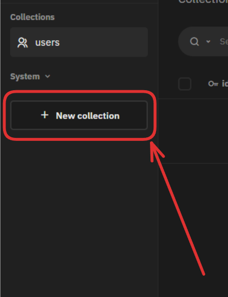

4. Введем название и выберем тип коллекции:
   - **Base** - обычная коллекция данных **(скорее всего в 99.9% понадобится именно он)**
   - **View** - коллекция-представление
   - **Auth** - новая коллекция пользователей данных

   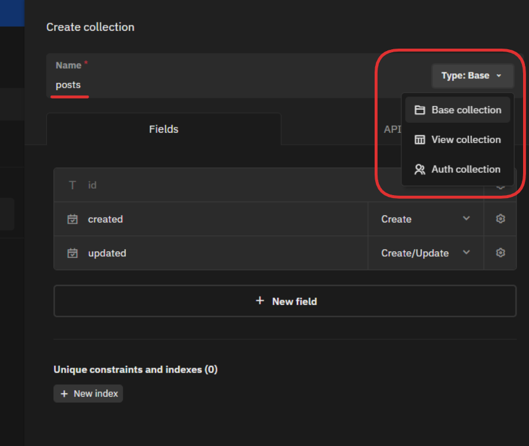

5. Добавим необходимые поля, например - содержимое поста, категорию и его владельца

   1. Нажимаем на "New field" и открывается выбор типа для поля:

      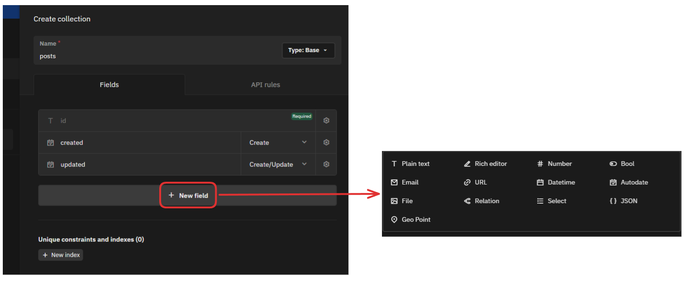

      При создании поля необходимо выбрать подходящий тип:

      | Тип | Пример |
      | --- | --- |
      | `Plain text` | Название, описание, адрес, комментарий |
      | `Number` | Количество, цена, рейтинг |
      | `Bool` | Признак или логическое значение |
      | `Date` | Дата и время |
      | `Email` | Адрес электронной почты |
      | `Select` | Одно или несколько значений из списка |
      | `Relation` | Связь с другой коллекцией |
      | `File` | Изображение или файл |
      | `JSON` | Структурированные дополнительные данные |

   2. Выбираем тип `Text` для содержимого поста и вводим название поля

      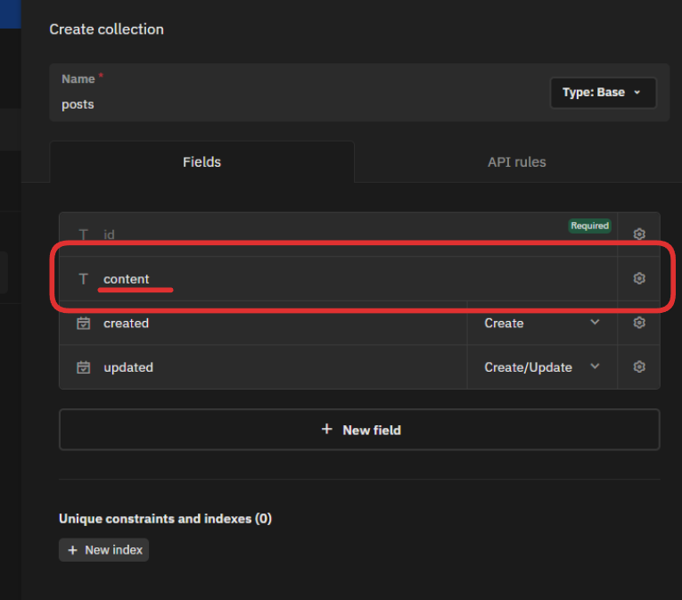

   3. Нажимаем на шестеренку и открываются подробные настройки у поля - можно настроить например минимальную/максимальную длину, обязательное ли это поле или нет и т.д.

      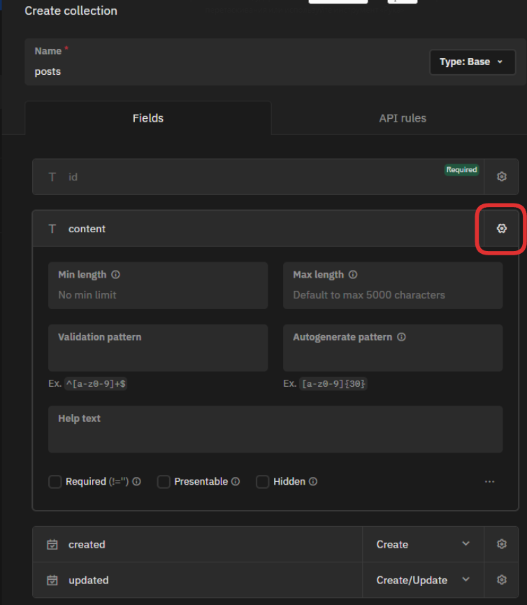

   4. Настроим так, как посчитаем нужным

      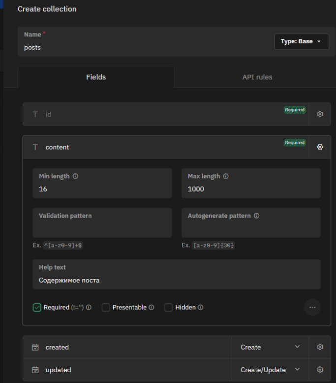

      Для обязательных значений необходимо включить ограничение **Required**. Для также можно при необходимости задать минимальное и максимальное значение - это особенно важно, например, для **цены**
      > Нельзя же выставить товар в магазин по цене `-999 руб.`

   5. Добавим поле для категории `category`, используем для этого `Select`

      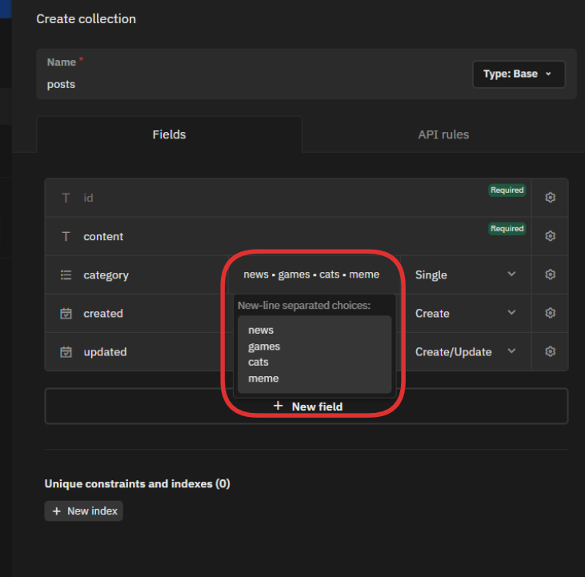

      У него можно указать виды через строчку и выбрать тип:
         - `Select` - одиночный выбор (например, у поста будет одна категория)
         - `Multiple` - можно выбрать несколько (например, у поста будет несколько категорий)

   6. А вот владелец поста это какой-то пользователь, то есть строчка из таблицы `users`, потому нужно добавить связь между постом и пользователем при помощи `Relation` - это закрепить один пост за конкретным юзером. Создадим поле `owner`

      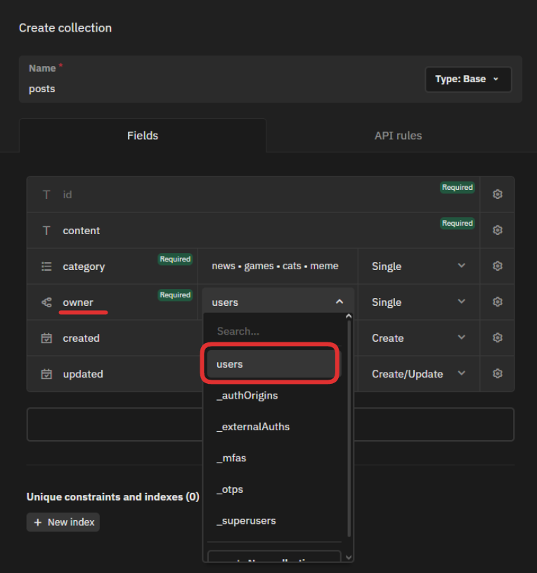

      Другие примеры:

      - заказ связан с пользователем
      - позиция заказа связана с товаром
      - бронирование связано с объектом размещения
      - отзыв связан с пользователем и объектом

   7. Теперь настроим правила доступа для этой таблицы. Переходим на вкладку `API rules`

      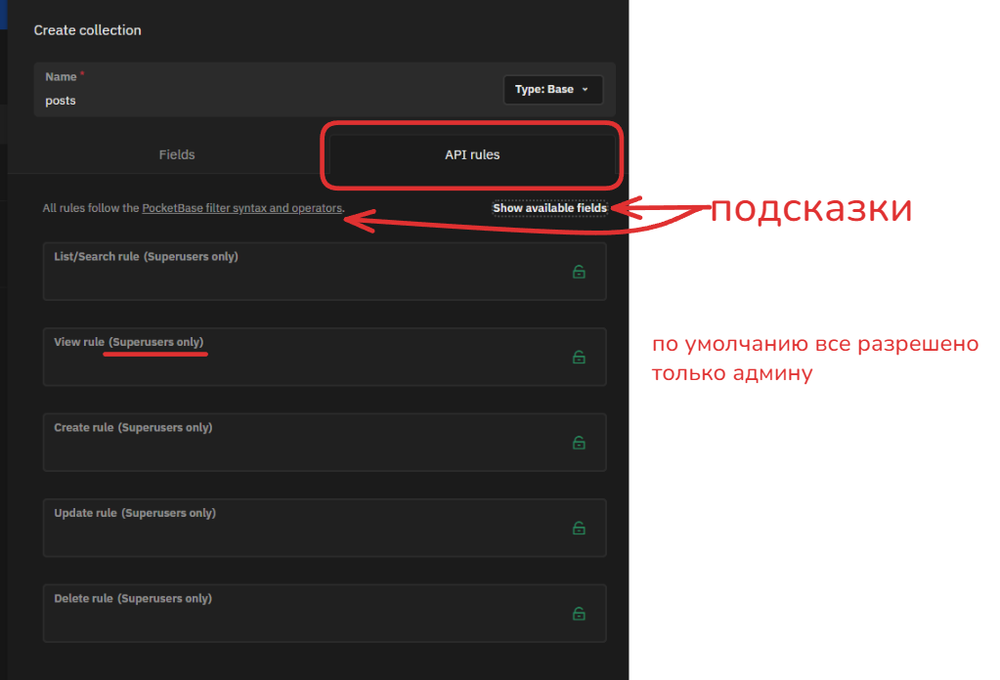

      Для каждой коллекции необходимо настроить правила доступа. Правило определяет, кто может читать, создавать, изменять или удалять записи. Мы увидим возможные операции над постами:

      - **List/Search** - получение списка элементов
      - **View** - получение одного элемента
      - **Create** - создание записи
      - **Update** - изменение записи
      - **Delete** - удаление записи

      По умолчанию все они `(Superuser only)`, то есть разрешены только администратору - разрешить их использовать можно нажав на зеленый замочек.

      Для наших постов **List/Search**, **View** и **Create** должны быть доступны любому, потому нажимаем на замочек и оставляем поля пустыми, а вот **Update** и **Delete** должны быть разрешены только владельцу поста, сделать это можно так:

      

      [Подробнее про настройки правил доступа можно почитать тут](https://pocketbase.io/docs/api-rules-and-filters/)

6. Сохраняем коллекцию

   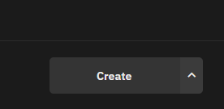

7. И мы увидим результат

   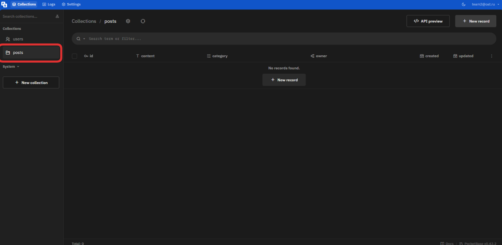

   У нас создалась наша коллекция с нашими полями, теперь можно добавлять данные при помощи кнопки `New record`

## 4. Тестовые данные

После создания коллекций добавьте тестовые записи, необходимые для разработки Android-приложения и тестирвания.

## 5. API PocketBase

Допустим у меня есть тестовые данные, как мне их получить? Чтобы с этим разобраться нажимаем на кнопку `API preview`

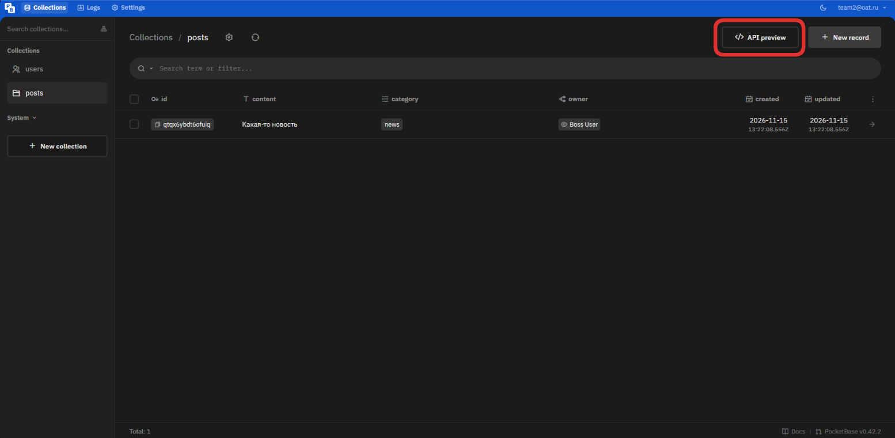

Откроется документация PocketBase по API для выбранной таблицы:

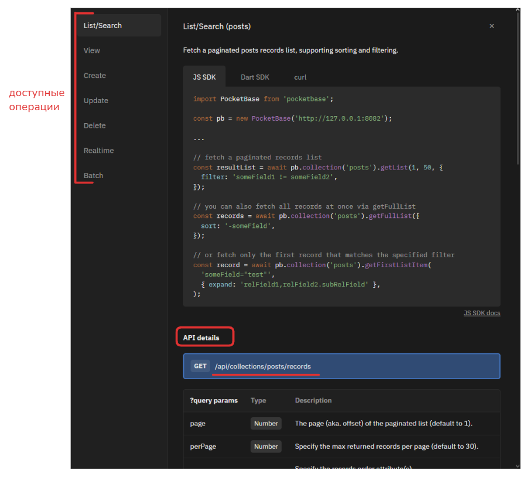

Слева вы увидете вкладки доступных операций над таблицей, для них мы как раз и настраивали правла доступа.

Пропускаем код - он нам не нужен (может только понадобится `curl` для тестировщика) - и спускаем сразу до заголовка API details, там написан адрес для запроса и его метод, например для наших постов он такой:

```text
GET /api/collections/posts/records
```

И чтобы получить полный адрес API нужно совместить его с нашим базовым адресом сервера, чтоб вышло примерно такое:

```text
http://<адрес-сервера>:<порт-группы>/api/collections/posts/records
```

И если мы в браузере/программе для тестирования обратимся к этому адресу, то получим:

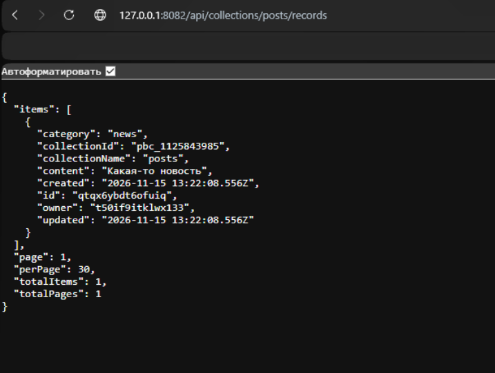

Вот какие есть операции и для чего они операции:

| Операция | HTTP-метод | Назначение |
| --- | --- | --- |
| Получение списка | GET | Получить записи коллекции |
| Получение записи | GET | Получить одну запись |
| Создание | POST | Создать новую запись |
| Изменение | PATCH | Изменить запись |
| Удаление | DELETE | Удалить запись |

## 6. Проверка готовности серверной части

Серверная часть считается подготовленной, если:

- все необходимые коллекции созданы
- поля соответствуют ER-диаграмме
- связи между коллекциями работают
- обязательные поля настроены
- правила доступа проверены
- тестовые данные добавлены
- регистрация и авторизация работают
- основные записи можно создавать и получать
- Android-разработчик получил описание API
