# Тестирование с помощью Hoppscotch

**Hoppscotch** – это платформа с открытым исходным кодом для разработки, тестирования и работы с API. Аналогами являются: Postman, Bruno и др.

В нашем случае, hoppscotch позволит удобно проверять работоспособность эндпоинтов, направляя по ним запросы, а так же создать конечную API документацию по всему сервису.

> [!NOTE] Справка
> _API (Application programming interface)_ — это *контракт*, который предоставляет программа. «Ко мне можно обращаться так и так, я обязуюсь делать то и это». В ходе практики вы будете работать с одним из архитектурных стилей написания API. Подробнее можете ознакомиться в следующей статье: https://habr.com/ru/articles/483202/

## Содержание

1. [Знакомство с интерфейсом](#знакомство-с-интерфейсом)
2. [Авторизация](#авторизация)
3. [Первый запрос](#первый-запрос)
4. [Команда](#команда)
5. [Коллекции](#коллекции)
6. [Документация](#документация)

## Знакомство с интерфейсом

В основе своей интерфейс hoppscotch интуитивно понятен, а так же имеет русскую локализацию, что помогает с освоением функционала сервиса. Однако, мы считаем нужным подчеркнуть для Вас те функции и возможности, которые понадобятся в ходе работы.

Начнем с главной страницы:

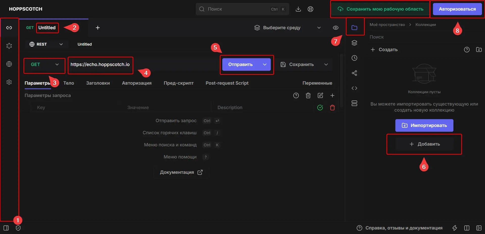

1. **Боковая панель** – для нас важны первая и последняя вкладки: REST и настройки. Вкладка REST позволяет нам отправлять RESTful запросы, но об этом позже. В настройках вы можете изменить интерфейс.
2. **Название текущего запроса** – отправляемые запросы можно сохранять и задавать им имена.
3. **Метод запроса** – HTTP метод RESTful запроса, среди самых часто используемых можно выделить:
   
   > [!TIP] На заметку
   > - **GET** – получить. Аналогично тому, как когда Вы заходите на страницу по указанному адресу.
   > - **POST** – отправить. Часто используется для занесения данных, например: создание нового товара.
   > - **PUT** – внести/поместить. **Полностью** обновить данные об объекте.
   > - **PATCH** – заменить. **Частично** обновить данные об объекте.
   > - **DELETE** – удалить.

4. **Адрес запроса** – именно по указанному в этом поле адресу будет происходить HTTP запрос с указанным методом.
5. **Кнопка отправки** – по нажатию отправляет запрос.
6. **Добавление новой коллекции** – создает новую коллекцию запросов. Как бы папка, где мы храним наши запросы.
7. **Выбор рабочего пространства** – в свою очередь рабочее пространство это уже папка для коллекций, папка для папок для папок для папок...
8. **Авторизация** – авторизация на сервис.
   
   > [!WARNING] Важно!
   > Авторизация происходит с помощью аккаунта Github. Почта, требующаяся для приглашения др. пользователей и регистрации также должна быть привязана к вашему аккаунта Github.
   
## Авторизация

Для начала нажмите на кнопку авторизации **\[8]**:

Затем авторизуйтесь через [GitHub](https://github.com):

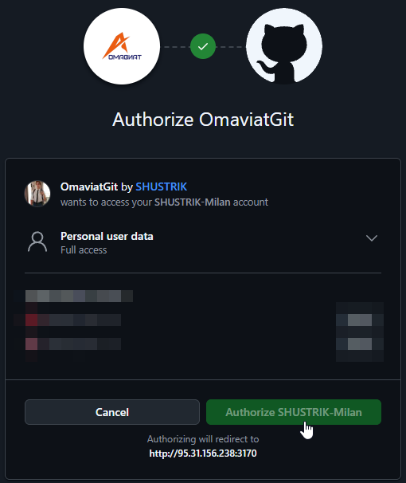

Отлично! Теперь Вы стали частью Hoppscotch комьюнити \[Слезы радости] \[Слезы радости]

## Первый запрос

И так, приступим к написанию первого запроса, или нескольких запросов. Для начала определим куда мы будем "стучаться", то есть обращаться с запросом. Для примера возьмем тестовое API с следующей "ручкой" (эндпоинтом):

- **GET** `https://fake-json-api.mock.beeceptor.com/users` – позволяет получить список пользователей.

Скопируем ссылку и вставим её в адрес запроса \[4]. Выберем соответствующий HTTP метод GET \[3] и нажмем на кнопку отправки \[5]

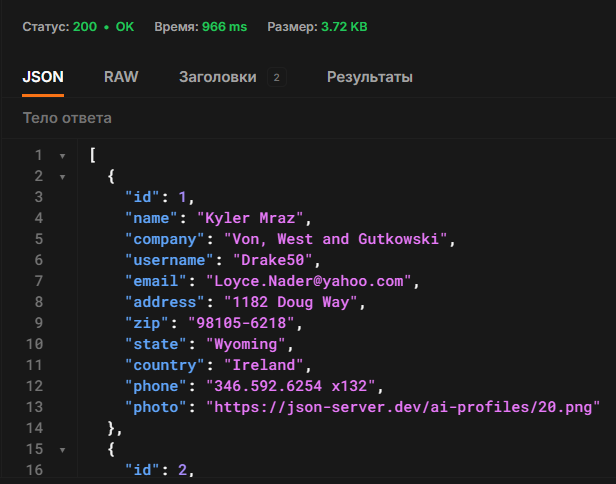

Отлично! Мы получили результат запроса в формате JSON. Помимо этого мы видим статус запроса. Тип запроса можно определить по первой цифре

> [!TIP] На заметку
> - **1xx** – информация. Например: запрос получен
> - **2xx** – успех. Например: 200 – запрос приехал до сервера.
> - **3xx** – редирект (переход на другую страницу).
> - **4xx** – клиентская ошибка. Ошибка с вашей стороны, как отправителя запросов. Например: неверный пароль.
> - **5xx** – серверная ошибка. Ошибка на стороне сервера.

Теперь сохраним ваш запрос. Для этого справа от клавиши "Отправить" \[5] нажмем "Сохранить":

Помимо названия, здесь вы можете указать коллекцию, в которую будет сохранен запрос. Для создания коллекций обратитесь к разделу [Коллекции](#коллекции).

Так же, мы можем сохранить Response'ы (ответы сервера), как примеры работы работы API.

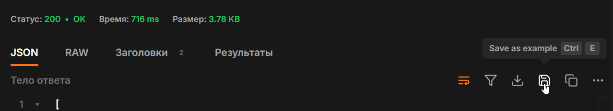

Это поможет на этапе создания [Документации](#документация)

## Команда

Поскольку работа происходит в командах, Вы можете подключить к своему рабочему пространству ещё одного человека. Для этого перейдите в свой профиль, нажав на аватарку в правом верхнем углу и перейдите в профиль. Перейдя во вкладку "Команды", нажмите "Создать новую команду":

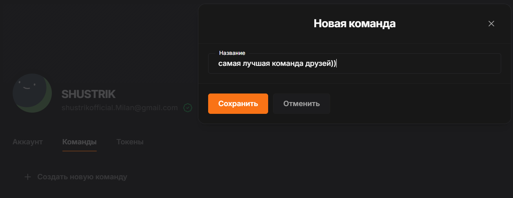

Задайте название и сохраните. Ваша команда появится в списке:

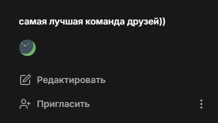

Нажав клавишу "Пригласить", Вы сможете добавить нового участника. 

> [!WARNING] Учтите
> Указываемая почта должна быть привязана к аккаунту GitHub

## Коллекции

Аналогично с коллекциями. На главном странице REST вы можете увидеть меню справа и клавишу "Добавить"

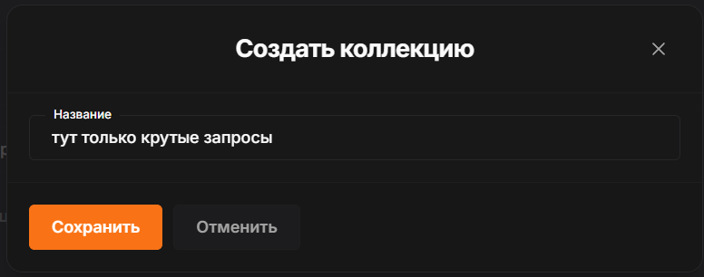

Теперь сохраним туда наш запрос:

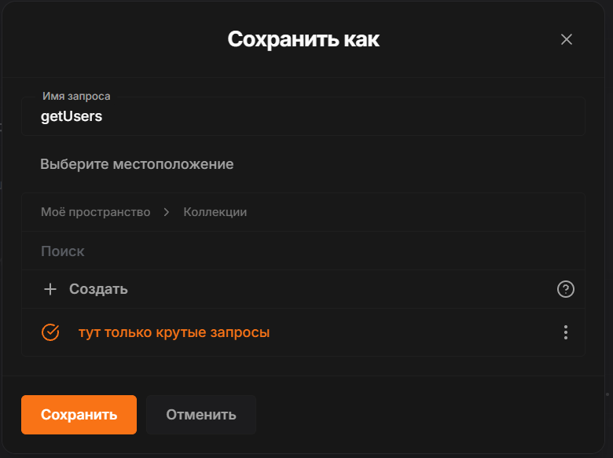

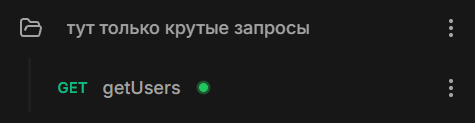

Успех!

## Документация

Теперь, когда у Вас есть коллекция с каким-то количеством сохраненных запросов и их ответов, мы можем создать документацию. Для этого нажмем правой кнопкой мыши по коллекции и выберем поле "Documentation"

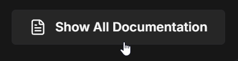

Для открытия полной документации нажмите клавишу "Show All Documentation"

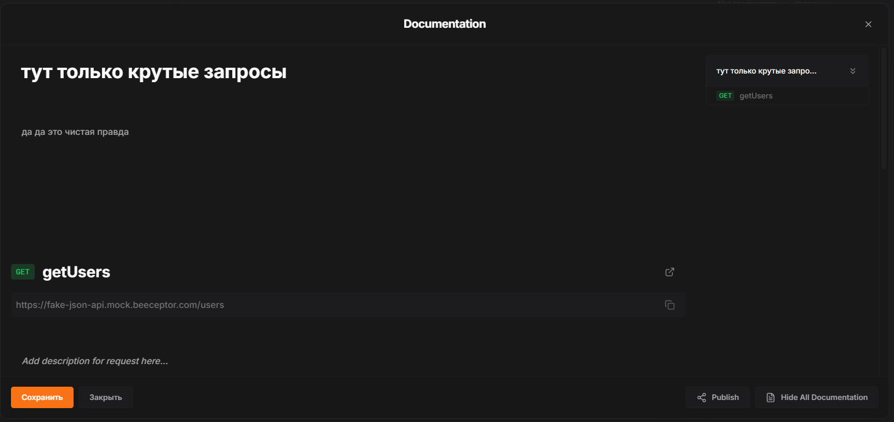

Здесь мы можем оформить документацию по вашему API и к каждому запросу добавить описание и увидеть Response Example'ы, которые мы сохраняли.

По итогу вы можете опубликовать свою документацию в общий доступ по нажатию кнопки "Publish".

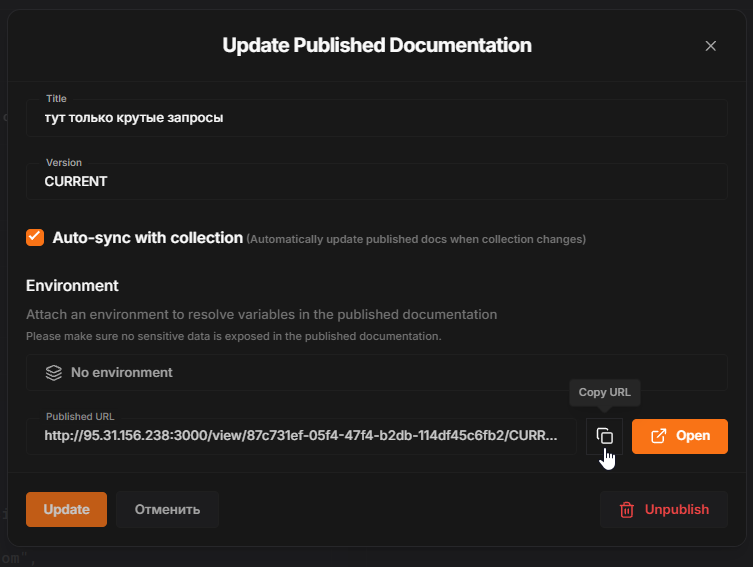

Итогом станет общедоступная ссылка, которую вы прикрепите к своему отчету.