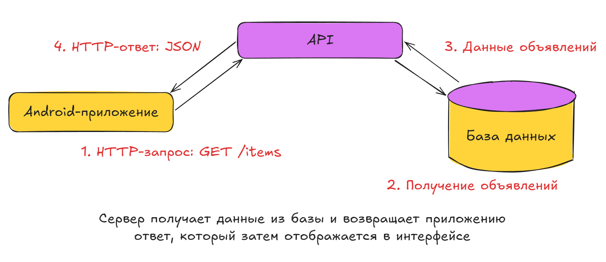
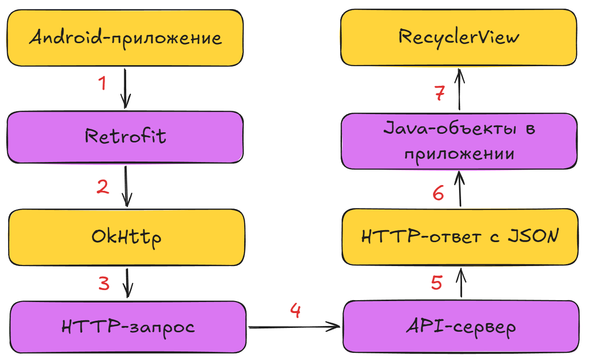

# Урок №11

## Клиент-серверное взаимодействие

### О чем этот урок?

До этого момента наше приложение работало преимущественно с локальными данными. Например, список объявлений создавался прямо в коде, а профиль и настройки сохранялись на устройстве.

Но представьте, что пользователь разместил объявление на одном телефоне. Как сделать так, чтобы другой пользователь увидел это объявление на своем устройстве? Хранить все объявления внутри каждого приложения неудобно: **данные не будут автоматически общими для всех пользователей.**

Для этого используется **клиент-серверная архитектура**. Приложение отправляет запросы на сервер, сервер обрабатывает их и возвращает ответ. Сегодня разберемся, как устроен этот процесс, что такое HTTP и кто такой JSON и какие инструменты будем использовать для подключения Android-приложения к серверу.

---

### Часть 1. Зачем приложению сервер?

Представим, что пользователь хочет открыть ленту объявлений.

Если приложение использует только локальные данные, список может выглядеть так:

```java
List<Item> items = new ArrayList<>();
items.add(new Item(
    "Велосипед",
    "12 000 ₽",
    "Городской велосипед в хорошем состоянии"
));
```

Такой подход подходит для обучения и демонстрации интерфейса. Но у него есть ограничение: **объявление существует только в данных конкретного приложения**. Другие пользователи не получат его автоматически.

Теперь добавим сервер. Он будет хранить общие данные, а приложение сможет получать их через сеть.

**Клиент** - приложение на устройстве пользователя. Оно показывает интерфейс и отправляет запросы.

**Сервер** - программа, которая принимает запросы, выполняет необходимые действия и возвращает результат.

**База данных** - место, где сервер может хранить объявления, пользователей и другие сведения.

Например, когда пользователь открывает ленту:

1. Android-приложение отправляет запрос серверу.
2. Сервер получает запрос и при необходимости обращается к базе данных.
3. Сервер формирует ответ.
4. Приложение получает ответ и отображает объявления на экране.

Важно: приложение обычно обращается **не к базе данных напрямую**, ***а к серверу***. Именно сервер определяет, какие данные можно получить и какие действия разрешено выполнять.



---

### Часть 2. Что такое API?

Чтобы приложение и сервер могли взаимодействовать, им нужен согласованный способ общения.

**API** - это интерфейс, через который одна программа может обращаться к возможностям другой программы.

В нашем проекте Android-приложение будет использовать API учебного сервера.

Документация API доступна по адресу:

`http://95.31.156.238:8000/docs`

Откройте документацию в браузере. В ней можно увидеть доступные операции, параметры запросов, ожидаемые ответы и возможность отправить тестовый запрос прямо из браузера.

Например, сервер может предоставлять следующие операции:

| Операция | Для чего нужна |
| --- | --- |
| Получение списка объявлений | Загрузить ленту |
| Получение категорий | Показать доступные категории |
| Получение одного объявления | Открыть подробную информацию |
| Регистрация пользователя | Создать учетную запись |
| Вход пользователя | Получить данные для авторизации |
| Создание объявления | Опубликовать новое объявление |

Это примеры назначения операций API. Точный адрес каждой операции, параметры и формат ответа нужно смотреть в документации сервера.

**У каждой операции есть свой адрес и правила использования. Android-приложение должно отправлять запросы в соответствии с этими правилами.**

---

### Часть 3. Что такое HTTP-запрос?

**HTTP** - это протокол, который определяет, как клиент и сервер обмениваются запросами и ответами.

У HTTP-запроса есть несколько важных частей:

| Часть | Что означает |
| --- | --- |
| URL | Адрес, по которому отправляется запрос |
| Метод | Какое действие мы хотим выполнить |
| Заголовки | Дополнительная информация о запросе |
| Тело запроса | Данные, которые клиент передает серверу, если они нужны |

Рассмотрим пример запроса для получения списка объявлений:

```http
GET /items HTTP/1.1
Host: 95.31.156.238:8000
```

Здесь `GET` - метод запроса, а `/items` - путь к операции на сервере. Это пример записи HTTP-запроса.

#### Основные HTTP-методы

| Метод | Для чего используется | Пример в нашем приложении |
| --- | --- | --- |
| `GET` | Получить данные | Загрузить список объявлений |
| `POST` | Отправить данные или создать ресурс | Зарегистрировать пользователя |
| `PATCH` | Частично изменить существующие данные | Изменить профиль |
| `DELETE` | Удалить ресурс | Удалить свое объявление |

`GET` обычно используется, когда мы хотим получить данные. `POST` часто используется, когда нужно передать данные на сервер, например при создании объявления или регистрации.

Но сам метод не гарантирует успешного выполнения операции. Сервер может отклонить запрос, например если данные некорректны или у пользователя недостаточно прав.

---

### Часть 4. Как сервер сообщает результат?

После запроса сервер возвращает ответ. В нем содержатся статус выполнения, заголовки и, если предусмотрено, тело ответа.

Для понимания результата особенно важен **HTTP-статус**.

| Статус | Значение |
| --- | --- |
| `200 OK` | Запрос успешно выполнен |
| `201 Created` | Ресурс успешно создан |
| `400 Bad Request` | Некорректный запрос |
| `401 Unauthorized` | Необходима авторизация или не приняты учетные данные |
| `403 Forbidden` | Недостаточно прав для выполнения действия |
| `404 Not Found` | Ресурс не найден |
| `500 Internal Server Error` | Внутренняя ошибка сервера |

Например, пользователь открывает объявление, которого больше нет. Сервер может вернуть `404`.

> Запомните: **успешно отправить запрос - не то же самое, что успешно выполнить операцию**. Приложение должно учитывать результат ответа.

Также бывают ситуации, когда сервер вообще не отвечает: отсутствует интернет, сервер недоступен или соединение прервалось. В таком случае мы можем не получить HTTP-статус, потому что ответ не был получен.

---

### Часть 5. В каком формате приходят данные? JSON

Серверу и приложению нужно передавать данные в формате, который обе стороны умеют понимать.

Один из распространенных форматов - **JSON**. Он позволяет представлять объекты, строки, числа, логические значения, массивы и другие данные.

Например, одно объявление может выглядеть так:

```json
{
  "title": "Велосипед",
  "price": 12000,
  "description": "Городской велосипед в хорошем состоянии"
}
```

Здесь:

- `title` - название
- `price` - цена
- `description` - описание

В Java мы можем представить эти данные классом:

```java
public class Item {
    private String title;
    private int price;
    private String description;

    public String getTitle() {
        return title;
    }

    public int getPrice() {
        return price;
    }

    public String getDescription() {
        return description;
    }
}
```

JSON - это формат данных, а не язык программирования и не сама база данных.

---

### Часть 6. Как будет выглядеть ответ со списком?

Когда мы работали с `RecyclerView`, адаптер получал список объектов `Item`:

```java
List<Item> items = new ArrayList<>();
items.add(new Item(/* данные объявления */));
```

Теперь источник данных изменится. Вместо создания списка вручную приложение будет получать данные от сервера.

Упрощенный пример ответа сервера со списком объявлений:

```json
{
  "items": [
    {
      "title": "Велосипед",
      "price": 12000,
      "description": "Городской велосипед"
    },
    {
      "title": "Учебник Java",
      "price": 700,
      "description": "Книга для начинающих"
    }
  ]
}
```

После получения данных приложение должно:

1. Разобрать JSON-ответ
2. Преобразовать данные в Java-объекты
3. Передать полученный список адаптеру
4. Обновить интерфейс

Сам `RecyclerView` при этом не обязан меняться. Он по-прежнему отображает объекты через адаптер. Изменяется прежде всего способ получения этих объектов.

---

### Часть 7. Как Android будет отправлять запросы?

В Android можно самостоятельно работать с HTTP-соединениями, но для учебного проекта удобнее использовать готовые библиотеки.

Мы будем рассматривать две библиотеки:

**OkHttp** - библиотека для выполнения HTTP-запросов. С ее помощью можно создавать запросы, задавать заголовки, отправлять данные и получать ответы

**Retrofit** - библиотека, которая помогает описывать HTTP-операции в виде Java-интерфейсов и преобразовывать ответы сервера в объекты

В нашем проекте **основным инструментом будет Retrofit**, а OkHttp пригодится для понимания того, что происходит под капотом, и для настройки запросов.

Упрощенно взаимодействие выглядит так:



На следующем занятии начнем настраивать Retrofit и отправим первый запрос на получение данных.

---

### Часть 8. Проверяем API через документацию

Прежде чем подключать Android-приложение, полезно убедиться, что мы понимаем работу самого API.

Откройте документацию:

`http://95.31.156.238:8000/docs`

Найдите операцию, которая позволяет получить список объявлений. В документации FastAPI она обычно представлена как `GET`-операция.

Порядок работы:

1. Откройте описание операции.
2. Посмотрите ее HTTP-метод и путь.
3. Изучите параметры, если они есть.
4. Нажмите `Try it out`, если эта кнопка доступна.
5. Нажмите `Execute`.
6. Посмотрите код ответа и тело ответа.

Если сервер доступен и операция не требует дополнительных условий, вы увидите результат выполнения запроса.

Обратите внимание на три вещи:

- Какой статус вернул сервер?
- В каком формате пришли данные?
- Какие поля присутствуют в ответе?

---

### Итог

Сегодня разобрали:

- **клиент** - Android-приложение, которое отправляет запросы
- **сервер** - обрабатывает запросы и возвращает результаты
- **API** - интерфейс для взаимодействия программ
- **HTTP** - протокол обмена запросами и ответами
- `GET`, `POST`, `PATCH` и `DELETE` - методы для разных операций
- **HTTP-статусы** - помогают понять результат выполнения запроса
- **JSON** - формат представления данных
- **Retrofit** - основной инструмент для подключения приложения к API
- **OkHttp** - HTTP-клиент, на котором может работать Retrofit
