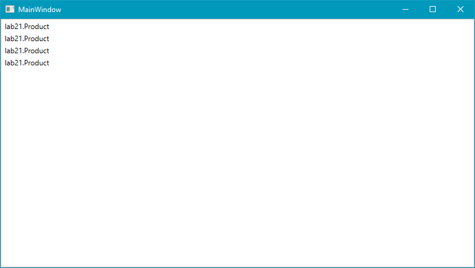
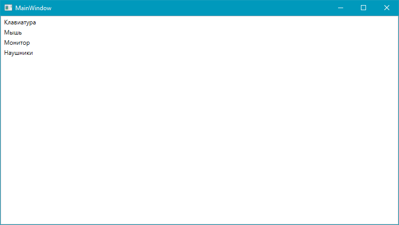
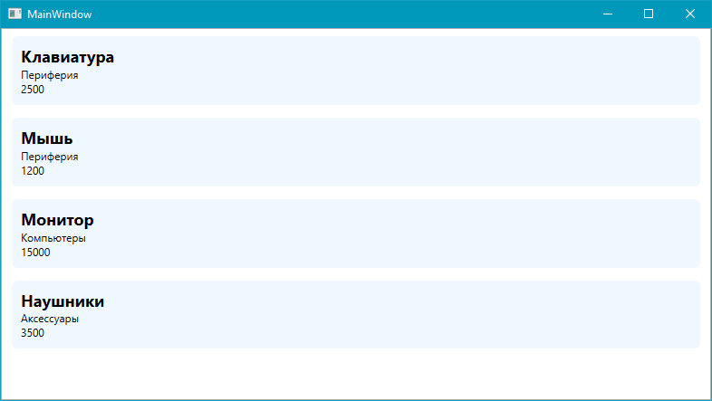

# Лабораторная работа  №21

## Создание и использование шаблонов

### Основные правила

1. Не бойтесь задавать любые вопросы
2. Если хотите сделать что-то свое, то предлагайте – будем думать
3. Советую читать текст, тут написано много полезного
4. 

### Цель работы

Научиться создавать и использовать `DataTemplate` для отображения объектов в элементах управления WPF

### Задачи

1. Создать класс для хранения информации о товаре
2. Подготовить коллекцию товаров
3. Отобразить коллекцию в `ListBox`
4. Создать `DataTemplate` для оформления карточек товаров
5. Изменить внешний вид карточек с помощью XAML

---

### Часть 1. Теория

#### Что такое `DataTemplate`?

`DataTemplate` - это **шаблон данных**, который определяет, как объект будет *отображаться* в приложении.

Предположим, что у нас есть три товара:

* Клавиатура, 2500 рублей
* Мышь, 1200 рублей
* Монитор, 15000 рублей

Каждый товар хранится в отдельном **объекте C#**. Но если просто поместить объекты в список, программа **не будет** автоматически отображать их *в виде красивой карточки*, потому что не знает как это делать.

Мы как раз можем **научить программу** делать это при помощи `DataTemplate`.

С помощью шаблона можно указать, что название товара должно отображаться крупным шрифтом, цена - отдельной строкой, а вся карточка должна иметь фон и отступы.

#### Шаг 1. Добавляем список на наш экран

И не забываем дать ему `Name` (или `x:Name` - без разницы), чтобы мы могли обратиться к нему из C# кода

```xml
<Grid>
    <ListBox Name="ProductsListBox"/>
</Grid>
```

#### Шаг 2. Создадим модель товара

Для хранения информации о товаре создайте отдельный класс. Не забудьте каждому полю добавить - `{ get; set; }`

```csharp
public class Product
{
    public string Name { get; set; }
    public decimal Price { get; set; }
    public string Category { get; set; }

    public Product(string name, decimal price, string category)
    {
        Name = name;
        Price = price;
        Category = category;
    }
}
```

Класс Product описывает товар и содержит три свойства:

* `Name` - название товара
* `Price` - цена товара
* `Category` - категория товара

#### Шаг 3. Добавим несколько товаров в список

Откройте код вашего экрана (это - `MainWindow.xaml.cs`) и допишите конструктор вашего окна:

```csharp
public MainWindow()
{
    InitializeComponent();

    // создаем переменную products и заполняем её
    List<Product> products = new List<Product> 
    {
        new Product("Клавиатура", 2500, "Периферия"),
        new Product("Мышь", 1200, "Периферия"),
        new Product("Монитор", 15000, "Компьютеры"),
        new Product("Наушники", 3500, "Аксессуары")
    };

    // подключаем наш список в ListBox
    ProductsListBox.ItemsSource = products;
}
```

И попробуйте запустить ваше приложение. Вы увидите примерно такой результат:



Ни названия, ни цены, ни категории мы не увидим. *Почему?* Потому что мы **не объяснили** программе как отображать наши объекты `Product`.

#### Шаг 4. Создадим простой DataTemplate

Теперь определим, как должен выглядеть каждый товар.

Вернемся в  `MainWindow.xaml` и немглшл изменим наш `ListBox`:

```xml
<ListBox Name="ProductsListBox">

    <ListBox.ItemTemplate>
        <DataTemplate>
            <TextBlock Text="{Binding Name}"/>
        </DataTemplate>
    </ListBox.ItemTemplate>

</ListBox>
```

Обратите внимание:

* `ItemTemplate` - это слот для шаблона
* `DataTemplate` - это то как выглядит шаблон, его правила
* `{Binding Name}` - получает название из свойства объекта Product

Запустите приложение



Теперь каждый элемент списка должен отображать название соответствующего товара. Причем, **мы не создавали 4 разных `TextBlock`** для каждого товара, **`ListBox` сделал все сам**

#### Шаг 5. Создадим простую карточку

Доработаем `DataTemplate`, чтобы каждый товар отображался в виде карточки.

Карточка должна содержать:

* название товар
* цену
* категорию
* фон и отступы

Используем элементы `Border`, `StackPanel` и `TextBlock`.

Пример структуры шаблона:

```xml
<ListBox Name="ProductsListBox" HorizontalContentAlignment="Stretch">
    <ListBox.ItemTemplate>
        <DataTemplate>
            
            <Border Background="AliceBlue" Padding="10" Margin="5" CornerRadius="6">
                <StackPanel>
                    <TextBlock Text="{Binding Name}" FontSize="18" FontWeight="Bold"/>
                    <TextBlock Text="{Binding Category}"/>
                    <TextBlock Text="{Binding Price}"/>
                </StackPanel>
            </Border>
            
        </DataTemplate>
    </ListBox.ItemTemplate>
</ListBox>
```

Обратите внимание:

* `Padding` - это внутренний отступ
* `Margin` - это внешний отступ
* `HorizontalContentAlignment` - отвечает за как выравниваются карточки по горизонтали, если `Stretch`, то растянутся на всю ширину

Запустите приложение и проверьте, что все товары отображаются в виде карточек.



---

### Часть 2. Самостоятельная работа

Создайте собственный список объектов с использованием `DataTemplate` и `ListBox`.

Выберите одну из тем:

* **Каталог книг** - название книги, автор, год издания
* **Каталог фильмов** - название фильма, жанр, год выпуска
* **Музыка** - название трека, артист, количество прослушиваний
* **Каталог игр** - название игры, жанр, цена
* **Своя тема**

### Итоговые требования

1. Создайте **класс-модель** для хранения данных (не менее 3 свойств)
2. Создайте `List` минимум из семи объектов
3. Отобразите коллекцию в `ListBox` с помощью `ItemsSource`
4. Создайте `DataTemplate`, который отображает свойства объекта в виде карточки
5. Оформите карточку с помощью элементов `Border`, `StackPanel` и `TextBlock`

### Дополнительно

Добавьте в класс-модель свойство для отображение картинки:

```csharp
// путь к файлу-картинке
public string ImagePath { get; set; } 
```

В карточку добавьте `<Image/>` и сделайте привязку `Source` к `ImagePath`
