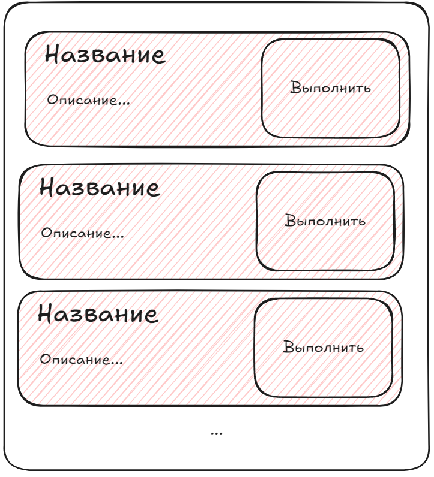
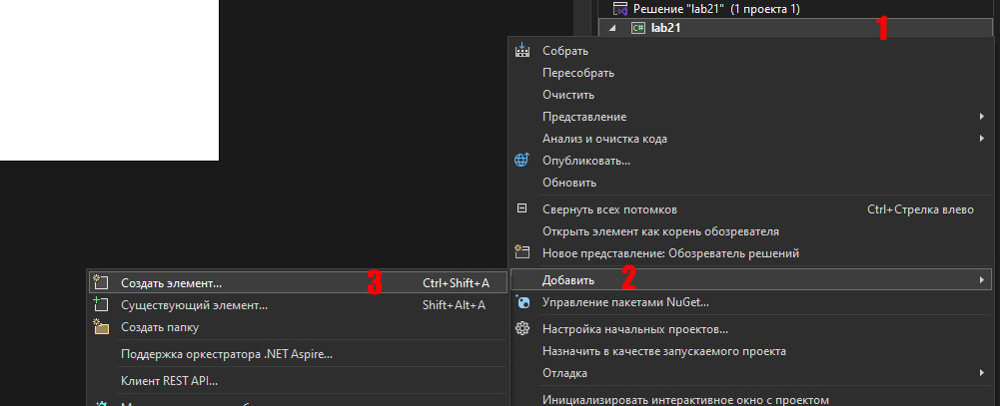
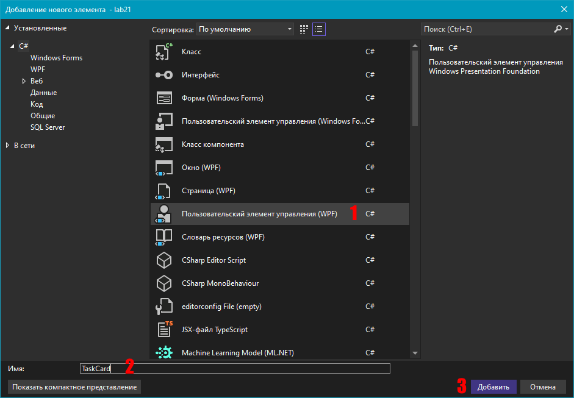
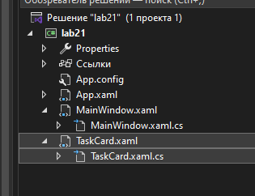
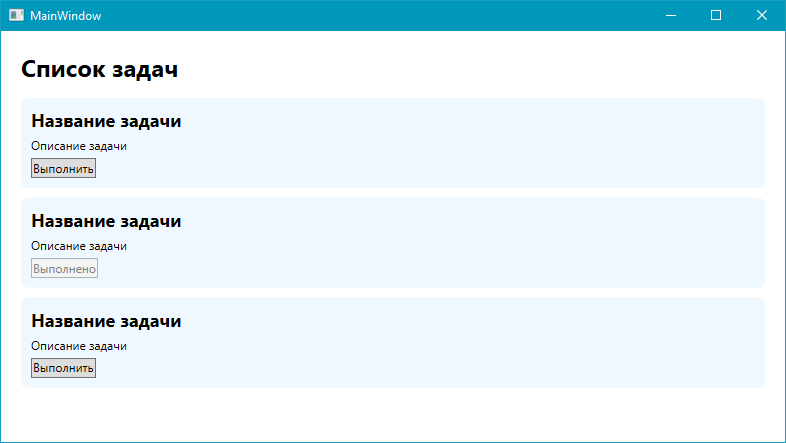

# Лабораторная работа  №22

## Создание пользовательских элементов управления

### Основные правила

1. Не бойтесь задавать любые вопросы
2. Если хотите сделать что-то свое, то предлагайте - будем думать
3. Советую читать текст, тут написано много полезного
4. 

### Цель работы

Научиться создавать пользовательские элементы управления в WPF и использовать их в приложении

### Задачи

1. Создать собственный элемент управления `UserControl`
2. Разработать его интерфейс с помощью XAML
3. Разместить несколько экземпляров компонента в главном окне
4. Реализовать простое взаимодействие с пользователем

---

### Часть 1. Теория

#### Что такое пользовательский элемент управления?

Предположим, что в приложении необходимо отображать задачи. Каждая задача содержит название, описание и кнопку для изменения статуса.



Можно каждый раз вручную создавать набор элементов `TextBlock`, `Border` и `Button`. Но если таких задач много, **XAML-код станет большим и неудобным**.

В WPF можно объединить несколько элементов интерфейса в один собственный компонент - `UserControl`.

После этого карточку можно будет **один раз написать**, а затем **повторно использовать** в разных частях приложения.

#### Шаг 1. Добавляем список на наш экран

В `MainWindow.xaml` разместите заголовок и панель для будущих элементов управления:

```xml
<StackPanel Margin="20">
    <TextBlock Text="Список задач" FontSize="24" FontWeight="Bold" Margin="0,0,0,15"/>
    <StackPanel x:Name="TasksPanel"/>
</StackPanel>
```

#### Шаг 2. Создаем элемент управления

В Visual Studio:

1. Нажмите правой кнопкой мыши на проект
2. Выберите **"Добавить"** -> **"Создать элемент..."**

3. Выберите `Пользователський элмент управления (WPF)`

4. Назовите файл `TaskCard`

Visual Studio создаст два файла:

- `TaskCard.xaml` - внешний вид компонента
- `TaskCard.xaml.cs` - код компонента



#### Шаг 3. Создаем интерфейс компонента

Откройте `TaskCard.xaml` и добавьте следующую разметку:

```xml
<Border Background="AliceBlue" Padding="10" Margin="0,0,0,10" CornerRadius="6">

    <StackPanel>
        <TextBlock Name="TitleText" Text="Название задачи" FontSize="18" FontWeight="Bold"/>
        <TextBlock Name="DescriptionText" Text="Описание задачи" Margin="0,5"/>
        <Button Name="StatusButton" Content="Выполнить" HorizontalAlignment="Left" Click="StatusButton_Click"/>
    </StackPanel>

</Border>
```

Внутри компонента находятся заголовок, описание и кнопка.

#### Шаг 4. Добавляем простое поведение

Откройте `TaskCard.xaml.cs`.

Добавьте в обработчик нажатия кнопки небольшой элемент логики:

```csharp
private void StatusButton_Click(object sender, RoutedEventArgs e)
{
    StatusButton.Content = "Выполнено";
    StatusButton.IsEnabled = false;
}
```

Теперь при нажатии кнопка изменит текст и станет недоступной.

> Пока что мы не размещали на нашем экране (`MainWindow`) созданный компонент, поэтому необходимо **его временно разместить там**, чтобы увидеть его. После запуска его можно будет убрать - будем создавать их из кода.

Запустите приложение и попробуйте нажать на кнопку.

#### Шаг 5. Используем компонент в главном окне

```csharp
public MainWindow()
{
    InitializeComponent();

    TasksPanel.Children.Add(new TaskCard());
    // и таким же образом еще несколько
}
```

Запустите приложение. В окне должны появиться три одинаковых карточки.

Нажмите кнопку в одной из и проверьте, что меняется только она.



#### Шаг 6. Настраиваем разные экземпляры

Сейчас все карточки выглядят одинаково. Давайте сделаем их содержимое разным.

В `TaskCard.xaml.cs` добавьте конструктор с параметрами:

```csharp
public TaskCard(string title, string description)
{
    InitializeComponent();

    TitleText.Text = title;
    DescriptionText.Text = description;
}
```

При этом **не трогайте** стандартный конструктор, созданный Visual Studio:

```csharp
public TaskCard()
{
    InitializeComponent();
}
```

Теперь в `MainWindow.xaml.cs` замените создание компонентов:

```csharp
public MainWindow()
{
    InitializeComponent();

    TasksPanel.Children.Add(
        new TaskCard(
            "Изучить WPF",
            "Разобраться с основными элементами интерфейса"
        )
    );

    // и таким же образом еще несколько
}
```

Запустите приложение.

Теперь у каждого экземпляра компонента свои название и описание, хотя все они используют одну разметку.

---

### Часть 2. Самостоятельная работа

Создайте собственный пользовательский элемент управления на одну из тем:

1. **Карточка книги** - название, автор, кнопка "Прочитано"
2. **Карточка фильма** - название, жанр, кнопка "Просмотрено"
3. **Карточка задачи** - название, описание, кнопка "Выполнено"
4. **Карточка игры** - название, жанр, кнопка "Выбрать"
5. **Своя тема**

### Итоговые требования

1. Создайте отдельный `UserControl`
2. Разместите внутри него минимум **3 элемента интерфейса**
3. Реализуйте простое действие **по нажатию кнопки**
4. Добавьте в главное окно минимум **5 экземпляров компонента**
5. Настройте для каждого экземпляра **собственное содержимое**
6. Измените оформление компонента в соответствии с **выбранной темой**

### Дополнительно

1. Добавьте отображение картинки в вашем компоненте
2. Добавьте в компонент еще одну кнопку или другое действие. Например, кнопку "Удалить", которая удаляет соответствующую карточку из главного окна
