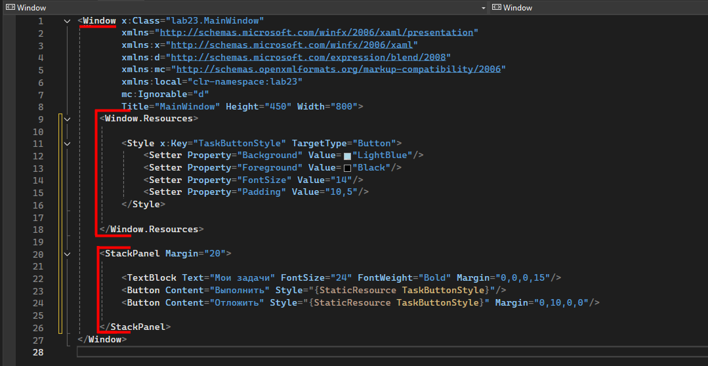
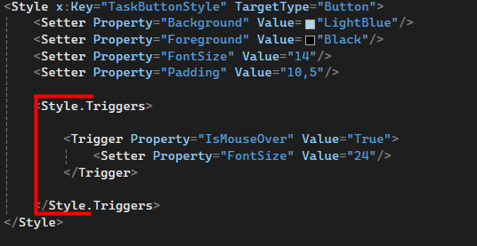

# Лабораторная работа № 23

## Использование стилей и триггеров для изменения вида отображения данных

### Основные правила

1. Не бойтесь задавать любые вопросы
2. Если хотите сделать что-то свое, то предлагайте - будем думать
3. Советую читать текст, тут написано **много полезного**

### Цель работы

Научиться создавать стили элементов управления WPF и использовать триггеры для автоматического изменения их внешнего вида в зависимости от состояния элемента

### Задачи

1. Познакомиться со стилями `Style` и свойствами `Setter`
2. Научиться применять один стиль к нескольким элементам управления
3. Создать триггер `Trigger` для изменения внешнего вида элемента
4. Использовать триггер для изменения оформления карточки при наведении курсора
5. Самостоятельно изменить стили и добавить собственное правило оформления

---

## Часть 1. Теория и практическая работа

### Что такое стиль?

Предположим, что в нашем приложении есть несколько кнопок. Мы хотим, чтобы все они имели **одинаковый** цвет фона, размер шрифта и отступы.

Можно задавать эти свойства для каждой кнопки отдельно - прописывая их в каждой из них. **Но** если кнопок много, XAML станет слишком длинным и неудобным, а изменение оформления потребует исправления **каждой кнопки**.

Потому в WPF для этого существуют **стили (`Style`)**.

Стиль позволяет **один раз** описать оформление элемента, а затем применять его к **нескольким** элементам управления.

Например, мы можем создать стиль для кнопок и использовать его во всем окне.

## Часть 2. Практическая работа

### Шаг 1. Создаем первый стиль

Откройте `MainWindow.xaml` и добавьте в разметку окна раздел `Window.Resources`:



> Обратите внимание, что `Window.Resources` располагается внутри `Window` **на одном уровне** `Grid` или `StackPanel`

```xml
<Window.Resources>

    <Style x:Key="TaskButtonStyle" TargetType="Button">
        <Setter Property="Background" Value="LightBlue"/>
        <Setter Property="Foreground" Value="Black"/>
        <Setter Property="FontSize" Value="14"/>
        <Setter Property="Padding" Value="10,5"/>
    </Style>

</Window.Resources>

<StackPanel Margin="20">

    <TextBlock Text="Мои задачи" FontSize="24" FontWeight="Bold" Margin="0,0,0,15"/>
    <Button Content="Выполнить" Style="{StaticResource TaskButtonStyle}"/>
    <Button Content="Отложить" Style="{StaticResource TaskButtonStyle}" Margin="0,10,0,0"/>

</StackPanel>
```

Разберем новые моменты:

- `Window.Resources` - раздел ресурсов окна, в котором можно хранить стили и другие объекты, доступные внутри этого окна
- `Style` - описание оформления элементов
- `x:Key="TaskButtonStyle"` - имя, по которому мы будем обращаться к стилю
- `TargetType="Button"` - указывает, что стиль предназначен только для кнопок
- `Setter` - задает значение определенного свойства
- `Style="{StaticResource TaskButtonStyle}"` - применяет созданный стиль к кнопке

Например:

```xml
<Setter Property="Background" Value="LightBlue"/>
```

означает, что фон кнопки будет светло-голубым.

То есть - мы написали оформление *один раз*, **но применили его к двум кнопкам.**

### Шаг 2. Что такое триггер?

Стиль задает обычное оформление элемента. Но иногда внешний вид должен изменяться *в зависимости от действий пользователя.*

Например:

- при наведении курсора кнопка меняет цвет
- при нажатии элемент получает другое оформление
- при определенном состоянии элемента изменяется цвет текста

Для этого в WPF используется **триггер (`Trigger`)**.

Триггер проверяет значение свойства элемента и применяет дополнительные настройки, если условие выполняется.

**Рассмотрим пример: кнопка должна менять размер грифта при наведении курсора.**

Внутри ранее созданного `Style` добавьте после последнего `Setter` следующий код:

```xml
<Style.Triggers>

    <Trigger Property="IsMouseOver" Value="True">
        <Setter Property="FontSize" Value="24"/>
    </Trigger>

</Style.Triggers>
```

Теперь стиль целиком будет выглядеть так:



Опять же разберем новые элементы:

- `Style.Triggers` - раздел, в котором описываются триггеры стиля
- `Trigger` - условие, при выполнении которого меняется оформление
- `Property="IsMouseOver"` - свойство, показывающее, находится ли курсор мыши над элементом
- `Value="True"` - условие выполняется, когда курсор находится над кнопкой
- `Setter` внутри триггера - задает новое значение свойства, пока условие выполняется

> **Запустите приложение и проверьте результат.** Наведите курсор на каждую кнопку, а затем уберите его.

### Шаг 3. Создаем стиль для карточек задач

Теперь применим изученный принцип к более крупному элементу интерфейса

Вместо отдельных кнопок создадим карточки задач. Для оформления карточек используем `Border`, который позволяет задать фон, отступы и скругление углов

Внутри `Window.Resources`, рядом со стилем кнопок, добавьте **еще один стиль**:

1. Пусть он будет называться `TaskCardStyle` и применяться только для `Border`
2. Пусть стиль меняет следующие свойства:
    - Фон будет светло-голубой
    - Внутренний отступ = 12
    - Внешний отступ снизу = 10
    - Радиус закругления = 8
3. Добавьте также в стиль триггер, который будет реагировать на `IsMouseOver` и менять фон на светло-желтый

Теперь замените содержимое `StackPanel` в главном окне следующим кодом:

```xml
<StackPanel Margin="20">

    <TextBlock Text="Мои задачи" FontSize="24" FontWeight="Bold" Margin="0,0,0,15"/>

    <Border Style="{StaticResource TaskCardStyle}">

        <StackPanel>
            <TextBlock Text="Изучить C#" FontSize="18" FontWeight="Bold"/>
            <TextBlock Text="Повторить основные конструкции языка" Margin="0,5,0,10"/>
            <Button Content="Выполнить" Style="{StaticResource TaskButtonStyle}"/>
        </StackPanel>

    </Border>

    <!-- самостоятельно ДОБАВЬТЕ сюда еще несколько таких же карточек задач, как минимум ДВЕ -->

</StackPanel>
```

> **Проверьте результат:**
>
> 1. Запустите приложение
> 2. Наведите курсор на первую карточку
> 3. Наведите курсор на вторую карточку
> 4. Уберите курсор с карточки

---

### Часть 2. Самостоятельная работа

Продолжите разработку приложения со списком задач, созданного в практической части

#### Задание

**Выделите одну из карточек задач**, чтобы она визуально отличалась от остальных.

Например, можно выделить важную задачу, изменив цвет её фона, цвет текста, размер заголовка или другие свойства оформления

> Для этого создайте отдельный стиль и примените его к выбранной карточке. Остальные карточки должны сохранить прежнее оформление

### Требования

1. Используйте стили `Style` для оформления карточек задач
2. Создайте дополнительный стиль `Style` для выделения одной карточки
3. Задайте в стиле не менее **3 свойств оформления** с помощью `Setter`
4. Примените новый стиль только к одной карточке

### Дополнительно

1. Создайте триггер, который одновременно изменяет **2 свойства**
2. Пусть карточка будет реализована через собственный `UserControl`, используя знания из [лабораторной работы № 22](https://github.com/aiinty/labs/blob/main/степ/22-создание-элементов-управления.md)
