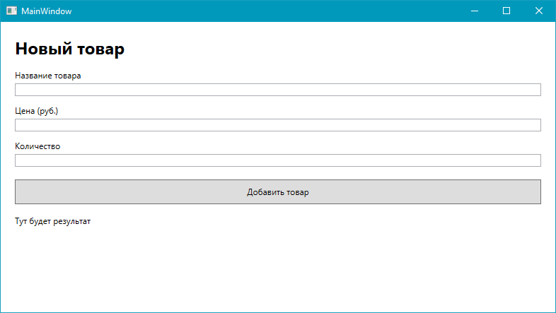

# Лабораторная работа № 24

## Валидация вводимых данных

### Основные правила

1. Не бойтесь задавать любые вопросы
2. Если хотите сделать что-то свое, то предлагайте - будем думать
3. Советую читать текст, тут написано **много полезного**

### Цель работы

Научиться проверять данные, которые пользователь вводит в элементы управления WPF, и отображать сообщения об ошибках до выполнения действия

### Задачи

1. Разобраться, зачем нужна валидация вводимых данных
2. Создать форму добавления товара
3. Проверить обязательность названия товара
4. Проверить, что цена является числом больше нуля
5. Проверить, что количество является целым неотрицательным числом
6. Запретить добавление товара, если введены некорректные данные

---

## Часть 1. Теория

### Что такое валидация?

Предположим, что в приложении пользователь добавляет товар в каталог. Для товара необходимо указать название, цену и количество.

Пользователь может случайно оставить **название пустым**, написать **вместо цены слово** или указать отрицательное количество. Если программа не проверяет ввод, такие данные могут привести к ошибкам или испортить содержимое приложения.

**Валидация** - это проверка того, соответствуют ли введенные данные установленным правилам.

Например:

- название товара обязательно
- цена должна быть числом больше нуля
- количество должно быть целым числом, равным нулю или больше

### Как можно проверять ввод в WPF?

Самый простой способ - прочитать текст из `TextBox` и проверить его в обработчике нажатия кнопки. Однако WPF также предоставляет встроенный механизм валидации через привязку данных (`Binding`) и класс `ValidationRule`.

В этой работе сначала выполним проверку при нажатии кнопки, чтобы сосредоточиться на самой логике валидации. Ошибки будем показывать с помощью `MessageBox`, а добавление товара выполнять только после успешной проверки всех полей.

## Часть 2. Практическая работа

### Шаг 1. Создаем форму

Откройте `MainWindow.xaml` и реализуйте окно по макету:



В форме есть три поля ввода (`TextBox`) и кнопка (`Button`). У каждого `TextBox` задано имя через `x:Name`, чтобы мы могли получить введенный текст из C#

- `NameTextBox` - название товара
- `PriceTextBox` - цена
- `QuantityTextBox` - количество
- `ResultTextBlock` - область, в которой выведем результат проверки

### Шаг 2. Проверяем обязательное поле

Откройте файл `MainWindow.xaml.cs`. Внутри класса `MainWindow` добавьте
обработчик кнопки:

``` csharp
private void AddButton_Click(object sender, RoutedEventArgs e)
{
    string name = NameTextBox.Text.Trim();

    if (string.IsNullOrWhiteSpace(name))
    {
        MessageBox.Show(
            "Введите название товара.",
            "Ошибка ввода",
            MessageBoxButton.OK,
            MessageBoxImage.Warning
        );

        NameTextBox.Focus();
        return;
    }

    MessageBox.Show("Название заполнено.");
}
```

Разберем моменты:

- `TextBox.Text` возвращает текст, который ввел пользователь в поле
- `Trim()` убирает пробелы в начале и конце строки
- `string.IsNullOrWhiteSpace()` проверяет, является ли строка пустой или состоит только из пробелов
- `MessageBox.Show()` показывает отдельное окно с сообщением
- `Focus()` переводит курсор в выбранное поле
- `return` прекращает выполнение обработчика. Поэтому при ошибке программа не продолжит проверку

> Запустите приложение и нажмите кнопку, оставив название пустым. Затем введите название и попробуйте снова

### Шаг 3. Проверяем цену

Теперь нужно убедиться, что цена введена корректно и больше нуля.

Дополните содержимое обработчика `AddButton_Click` следующим кодом:

``` csharp
private void AddButton_Click(object sender, RoutedEventArgs e)
{
    //... до этого тут идет проверка имени ...

    if (!decimal.TryParse(PriceTextBox.Text, out decimal price))
    {
        MessageBox.Show("Цена должна быть числом.");
        PriceTextBox.Focus();
        return;
    }

    if (price <= 0)
    {
        MessageBox.Show("Цена должна быть больше нуля.");
        PriceTextBox.Focus();
        return;
    }

    MessageBox.Show($"Название: {name}\nЦена: {price} руб.");
}
```

Обратите внимание на `decimal.TryParse()`.

Этот метод пытается преобразовать строку в число типа `decimal`. Если преобразование удалось, метод возвращает `true` и записывает результат в переменную `price`. Если пользователь ввел, например, `abc`, преобразование не удастся и программа покажет сообщение.

> Проверьте варианты:
>
> - `abc` - должно появиться сообщение, что цена должна быть числом
> - `0` - цена не пройдет проверку
> - `-50` - цена не пройдет проверку
> - `250` - проверка цены должна пройти

### Шаг 4. Проверяем количество

Теперь **самостоятельно** реализуйте проверку количества товара по примеру [того что делали с ценой](#шаг-3-проверяем-цену).

Количество должно быть **целым** неотрицательным числом, потому для проверки используем `int.TryParse()`

Дополните обработчик на окончательно:

``` csharp
private void AddButton_Click(object sender, RoutedEventArgs e)
{
    //... до этого тут идет проверка имени и цены ...

    // тут реализуйте проверку для количества

    ResultTextBlock.Text =
        $"Товар добавлен!\nНазвание: {name}\nЦена: {price} руб.\nКоличество: {quantity} шт.";

    MessageBox.Show("Данные проверены. Товар можно добавить.");
}
```

Почему для количества используем именно `int`, а не `decimal`?

Количество отдельных товаров обычно выражается **целым числом**: нельзя же купить 2.5 товара. Тут либо 2 штуки, либо 3 - другого не дано.

---

### Часть 3. Самостоятельная работа

Продолжите разработку приложения, созданного в практической части

#### Задание

**Добавьте еще одно поле ввода на главный экран**. Пусть можно будет ввести например производителя товара - соответственно надо дополнить проверку данных.

### Требования

1. Создайте форму минимум с тремя полями ввода
2. Проверьте, что обязательные текстовые поля не пустые
3. Проверьте, что числовые поля действительно содержат числа
4. Добавьте проверку диапазона хотя бы для 1 значения
5. Покажите понятное сообщение об ошибке

### Дополнительно

1. Вместо отдельных окон `MessageBox` выводите сообщение об ошибке рядом с соответствующим полем
2. Изменяйте цвет поля с ошибкой, например на светло-красный
3. Добавьте кнопку "Очистить", которая очищает все поля и сообщение о результате
