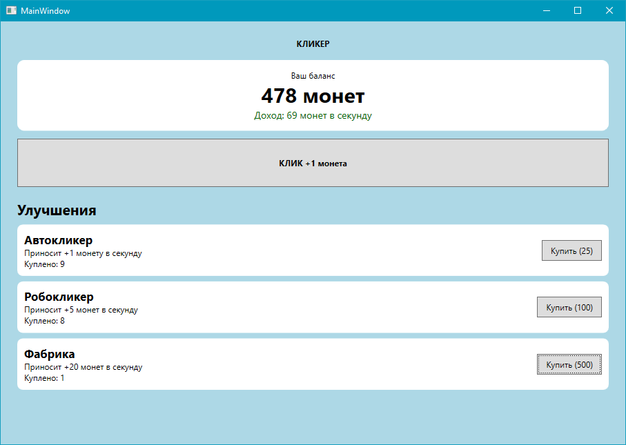
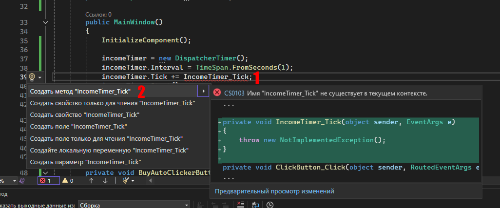

# Лабораторная работа № 25

## Создание задержек. Использование таймера

### Основные правила

1. Не бойтесь задавать любые вопросы
2. Если хотите сделать что-то свое, то предлагайте - будем думать
3. Советую читать текст, тут написано **много полезного**

### Цель работы

Научиться использовать таймер в WPF-приложении для выполнения действий через заданные промежутки времени

### Задачи

1. Создать простую игру-кликер
2. Реализовать начисление денег при нажатии на кнопку
3. Создать таймер, который автоматически начисляет пассивный доход
4. Добавить возможность покупать улучшения
5. Научиться запускать и останавливать таймер



---

## Часть 1. Теория

### Что такое таймер?

Иногда программе нужно выполнять действие не один раз, а **регулярно** - например, каждую секунду начислять игроку деньги, обновлять часы или проверять состояние приложения.

Для этого можно использовать **таймер**.

В WPF для простых периодических действий удобно применять `DispatcherTimer`. Он вызывает событие через заданные интервалы времени и позволяет обновлять элементы интерфейса.

Основные элементы таймера:

- `Interval` - промежуток времени между срабатываниями
- `Tick` - событие, которое вызывается при очередном срабатывании
- `Start()` - запуск таймера
- `Stop()` - остановка таймера

### Что будем создавать?

Создадим простую игру «Печеньковая империя».

Правила игры:

1. Игрок нажимает на кнопку "КЛИК" и получает 1 монету
2. За накопленные монеты можно покупать улучшения
3. Улучшения автоматически приносят монеты каждую секунду
4. Чем больше улучшений куплено, тем быстрее растет баланс

У нас будет всего три улучшения:

| Улучшение | Цена | Доход |
| --- | ---: | ---: |
| Автокликер | 25 монет | +1 монета/сек |
| Робокликер | 100 монет | +5 монет/сек |
| Фабрика | 500 монет | +20 монет/сек |

---

## Часть 2. Практическая работа

### Шаг 1. Создаем интерфейс игры

Откройте `MainWindow.xaml` и замените содержимое разметки следующим кодом:

```xml
<Grid Background="LightBlue">
    <StackPanel Margin="24">
        <TextBlock Text="КЛИКЕР" FontWeight="Bold" HorizontalAlignment="Center" Margin="0,0,0,16"/>

        <Border Background="White" CornerRadius="10" Padding="14" Margin="0,0,0,12">
            <StackPanel>
                <TextBlock Text="Ваш баланс" HorizontalAlignment="Center"/>
                
                <TextBlock x:Name="MoneyTextBlock" Text="0 монет" FontSize="30" 
                           FontWeight="Bold" HorizontalAlignment="Center"/>
                
                <TextBlock x:Name="IncomeTextBlock" Text="Доход: 0 монет в секунду"
                           FontSize="14" HorizontalAlignment="Center" Foreground="DarkGreen"/>
            </StackPanel>
        </Border>

        <Button Name="ClickButton" Content="КЛИК +1 монета" FontWeight="Bold" 
                Height="70" Margin="0,0,0,18" Click="ClickButton_Click"/>

        <TextBlock Text="Улучшения" FontSize="21" FontWeight="Bold" Margin="0,0,0,8"/>

        <Border Background="White" CornerRadius="8" Padding="10" Margin="0,0,0,8">
            <Grid>
                <Grid.ColumnDefinitions>
                    <ColumnDefinition Width="*"/>
                    <ColumnDefinition Width="Auto"/>
                </Grid.ColumnDefinitions>

                <StackPanel>
                    <TextBlock Text="Автокликер" FontSize="17" FontWeight="Bold"/>
                    <TextBlock Text="Приносит +1 монету в секунду"/>
                    <TextBlock Name="AutoClickerCount" Text="Куплено: 0"/>
                </StackPanel>

                <Button Name="BuyAutoClickerButton" Grid.Column="1" Content="Купить (25)" Padding="12,6" 
                        VerticalAlignment="Center" Click="BuyAutoClickerButton_Click"/>
            </Grid>
        </Border>
        
    </StackPanel>
</Grid>
```

> **Запустите приложение** и проверьте, что окно открывается. Пока ничего не работает - мы добавим логику на следующих шагах

### Шаг 2. Создаем переменные и таймер

Откройте `MainWindow.xaml.cs`.

Внутри класса `MainWindow`, но вне методов, добавьте поля:

```csharp
private int money = 0;
private int incomePerSecond = 0;

private int autoclickerCount = 0;

private DispatcherTimer incomeTimer;
```

Что хранят переменные?

- `money` - текущий баланс игрока
- `incomePerSecond` - сколько монет игрок получает каждую секунду
- `autoclickerCount` - количество купленных улучшений
- `incomeTimer` - таймер пассивного дохода

Теперь в существующий конструктор `MainWindow()` добавьте настройку таймера:

```csharp
public MainWindow()
{
    InitializeComponent();

    incomeTimer = new DispatcherTimer();
    incomeTimer.Interval = TimeSpan.FromSeconds(1);
    incomeTimer.Tick += IncomeTimer_Tick;
    incomeTimer.Start();
}
```

Здесь мы создаем таймер, устанавливаем интервал в одну секунду, подключаем обработчик `IncomeTimer_Tick` - именно он будет вызываться каждую секунду, а затем запускаем таймер.

Не забыаваем также создать сам обработчик `IncomeTimer_Tick`:



> Уберите из `IncomeTimer_Tick` какой-либо код - пусть он останется пока что пустым.

### Шаг 3. Обновляем отображение баланса

Чтобы не повторять одни и те же строки кода после каждого действия, создадим отдельный метод.

Добавьте в класс `MainWindow`:

```csharp
private void UpdateInterface()
{
    MoneyTextBlock.Text = $"{money} монет";
    IncomeTextBlock.Text = $"Доход: {incomePerSecond} монет в секунду";

    AutoClickerCount.Text = $"Куплено: {autoclickerCount}";
}
```

Метод `UpdateInterface()` обновляет текстовые элементы, чтобы игрок видел актуальный баланс, доход и количество улучшений.

### Шаг 4. Добавляем заработок за клик

Создайте обработчик кнопки печеньки:

```csharp
private void CookieButton_Click(object sender, RoutedEventArgs e)
{
    money++;
    UpdateInterface();
}
```

Теперь каждое нажатие на кнопку увеличивает баланс на одну монету. После изменения баланса вызывается `UpdateInterface()`, чтобы новое значение сразу появилось на экране.

> **Запустите программу** и проверьте: и понажимайте на кнопку, баланс должен увеличиваться

### Шаг 5. Реализуем пассивный доход

Реализуем обработчик события `Tick`:

```csharp
private void IncomeTimer_Tick(object sender, EventArgs e)
{
    money += incomePerSecond;
    UpdateInterface();
}
```

Таймер вызывает этот метод примерно раз в секунду. Метод к текущему балансу прибавляет значение прибыли в секунду.

Пока доход равен нулю, ничего не меняется. Когда игрок купит улучшение, значение дохода увеличится - и таймер начнет автоматически начислять больше монет.

### Шаг 6. Добавляем покупку улучшений

Теперь реализуем покупку Автокликера. Добавьте обработчик:

```csharp
private void BuyAutoClickerButton_Click(object sender, RoutedEventArgs e)
{
    int price = 25;

    if (money < price)
    {
        MessageBox.Show("Недостаточно монет для покупки автокликера");
        return;
    }

    money -= price;
    incomePerSecond += 1;
    autoclickerCount++;

    MessageBox.Show("Вы купили автокликер!");
    UpdateInterface();
}
```

Разберем логику:

1. В переменной `price` хранится стоимость нашего улучшения
2. Если денег меньше цены (`money < price`), то выводится сообщение и обработчик завершается через `return`
3. Если денег хватает, стоимость вычитается из баланса (`money -= price`)
4. Пассивный доход увеличивается на одну монету в секунду (`incomePerSecond += 1`)
5. Счетчик купленных автокликеров увеличивается (`autoclickerCount++`)
6. Интерфейс обновляется

> По аналогии реализуйте два оставшихся улучшения, которые [были описаны тут](#что-будем-создавать): **Робокликер** и **Фабрика**

---

### Требования

1. Реализуйте заработок монет при нажатии на кнопку
2. Используйте `DispatcherTimer` для начисления пассивного дохода
3. Добавьте минимум три покупаемых улучшения
4. Проверяйте, достаточно ли денег для покупки
5. После покупки обновляйте баланс и доход

### Дополнительно

1. Сделайте стоимость улучшения возрастающей после каждой покупки
2. Добавьте бонус, который временно удваивает доход
3. Показывайте сообщение, когда игрок впервые накопил 1000 монет
4. Добавьте возможность начать игру заново, обнулив баланс, доход и количество улучшений
